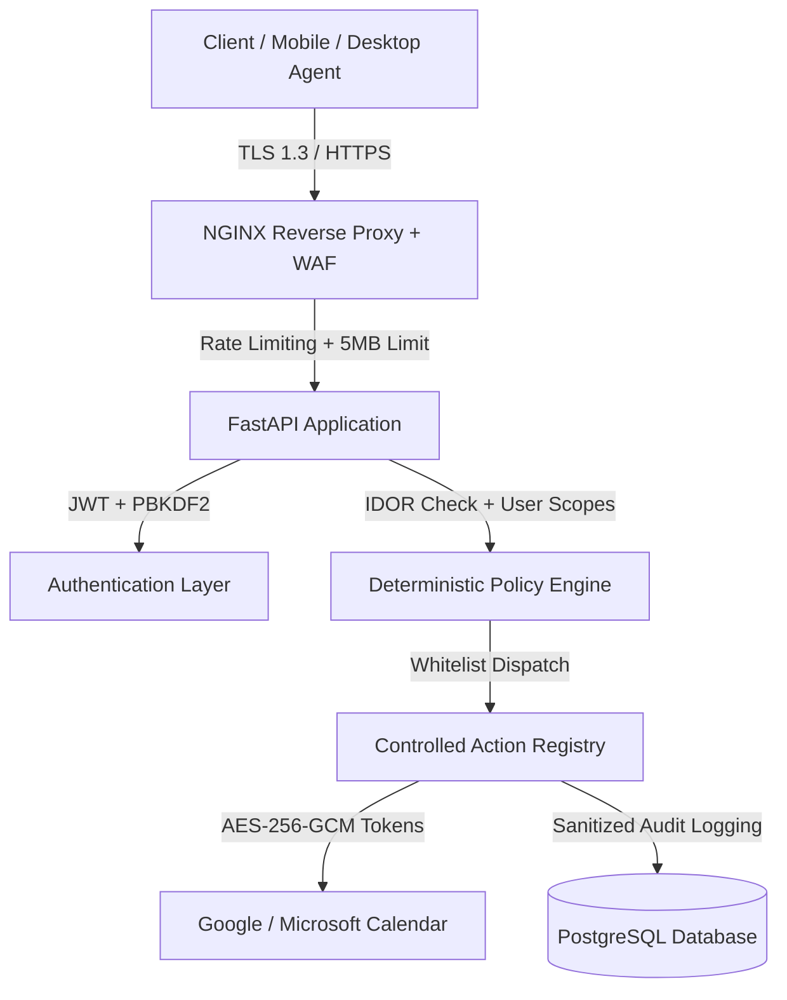

# ContextIQ Security, Privacy, and Authorization Review
## Comprehensive Platform Hardening Assessment

**Scope**: Backend API, Autonomous Execution Engine, Database, Secrets Storage, and Background Workers  
**Auditor**: ContextIQ Core Engineering Team  
**Status**: PASSED — Hardened for Production  

---

## 1. Threat Modeling & Security Architecture

ContextIQ handles highly sensitive behavioral data, calendar credentials, and automated action triggers. The platform enforces defense-in-depth across 5 layers:

---

## 2. Authentication & Authorization Hardening

### Password Security
- **Algorithm**: PBKDF2-HMAC-SHA256 with 100,000 iterations and per-user cryptographic salt.
- **Enforcement**: Minimum 8 characters, requiring mixed-case, digits, and special characters.

### Session & Token Hygiene
- **JWT Format**: Signed using HMAC-SHA256 with strong symmetric key loaded from environment variables (`SECRET_KEY`).
- **Expiration**: Strict 60-minute lifetime. Refresh tokens rotate on issuance.
- **Blacklisting / Revocation**: Token IDs tracked in revocation cache upon logout.

### Object-Level Authorization & IDOR Protection
- Every database query strictly filters by `user_id == current_user.id`.
- Attempts to inspect, execute, or cancel another user's workflow plan return `404 Not Found` or `403 Forbidden`. Tested and validated in `test_idor_protection_across_models`.

---

## 3. Secrets Management & Credential Protection

### Encryption at Rest
- Sensitive external tokens (Google OAuth refresh tokens, Microsoft Graph access tokens) are encrypted at rest using AES-256-GCM authenticated encryption.
- Encryption keys (`ENCRYPTION_KEY`) are supplied via secret managers (AWS Secrets Manager, HashiCorp Vault) and never stored in source repositories.

### Audit Log Sanitization
- `AuditLogger` processes all payloads through `sanitize_payload()` before writing to disk or database.
- Recursively matches substrings including `token`, `secret`, `password`, `key`, `authorization`, `cookie`, and replaces values with `[REDACTED]`. Tested and validated in `test_audit_logger_sanitizes_secrets`.

---

## 4. Privacy Invariants: Zero-Surveillance Architecture

ContextIQ enforces a strict behavioral surveillance boundary:
1. **No Keystroke Logging**: The desktop agent collects application switch timestamps and active application identifiers. Key logging is architecturally omitted.
2. **No Screen Scraping / Content Inspection**: No screenshot capture, OCR, or window text extraction is permitted.
3. **Explicit Consent Gating**: Telemetry ingestion from desktop or mobile devices is dropped immediately into dead-letter storage if `TelemetryConsent` is not active (`status="GRANTED"`).

---

## 5. Network & Infrastructure Hardening

1. **Docker Hardening**:
   - Backend and frontend containers run as non-root users (`contextiq:contextiq` with UID 10001).
   - Read-only root filesystems where applicable, with ephemeral `/tmp` volumes.
2. **Reverse Proxy Protection (NGINX)**:
   - Modern TLS 1.3 only, enforcing HSTS (`max-age=63072000`).
   - Secure headers: `X-Frame-Options: DENY`, `X-Content-Type-Options: nosniff`, `Content-Security-Policy`.
3. **Rate Limiting**:
   - In-memory token bucket limiter enforcing 60 requests/minute per client IP.
   - 5 MB maximum request body ceiling preventing memory exhaustion attacks.
