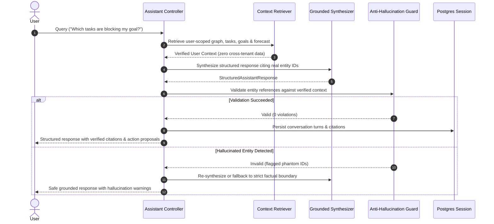

# Grounded Conversational Productivity Assistant Guide

## 1. Overview

ContextIQ includes a specialized **Knowledge-Grounded Conversational Assistant**. Unlike general-purpose chatbots that may hallucinate task deadlines, fake priorities, or invent progress metrics, the ContextIQ Assistant employs deterministic data retrieval, anti-hallucination verification gates, and structured response schemas.

---

## 2. Conversational Pipeline Architecture

---

## 3. Grounded Context Retrieval

Before answering any query, the [AssistantContextRetriever](file:///e:/Downloads 🔃/ContextIQ-main/ContextIQ-main/backend/app/services/assistant_context_retriever.py) constructs a `RetrievedUserContext` comprising:
- Active and completed tasks within the lookback window.
- Strategic goals and milestone progress.
- Discovered blockers and dependency relationships.
- Most recent project forecasts and risk tiers.
- Behavioral memory preferences and optimal focus windows.
- Recommendation feedback history.

---

## 4. Anti-Hallucination Guardrail

The [AntiHallucinationGuard](file:///e:/Downloads 🔃/ContextIQ-main/ContextIQ-main/backend/app/services/assistant_service.py#L42) runs before any response is rendered:
1. **Entity Verification**: Ensures every cited `task_id`, `project_id`, or `goal_id` exists in the retrieved user context.
2. **State Consistency**: Checks that completed tasks are not referred to as open blockers.
3. **Data Grounding**: Rejects claims with fabricated metrics or non-existent calendar events.

---

## 5. Structured Action Proposals

The assistant doesn't just provide static prose; it emits structured executable action proposals:
- `SCHEDULE_FOCUS_SESSION`: Suggests a calendar slot during the user's verified peak focus window.
- `UNBLOCK_TASK`: Proposes prioritizing a blocking dependency.
- `EXTEND_DEADLINE`: Suggests milestone adjustments based on forecast simulations.
- `ACCEPT_RECOMMENDATION`: Applies vetted productivity interventions.

---

## 6. API Endpoints

- `POST /api/v1/assistant/ask`: Submit query with optional conversation session ID.
- `GET /api/v1/assistant/conversations`: List user conversation threads.
- `GET /api/v1/assistant/conversations/{id}`: Retrieve message history and attached evidence citations.
- `DELETE /api/v1/assistant/conversations/{id}`: Archive conversation thread.
