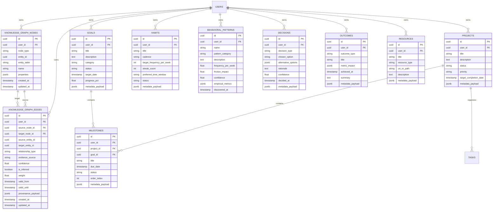

# ContextIQ Knowledge Graph Schema Specification
## Unified Multi-Relational Data Model (Phase 8.1)

---

## 1. Schema Overview & Design Philosophy

The ContextIQ Knowledge Graph Schema is designed to unify operational productivity entities, behavioral telemetry, predictive models, and autonomous governance into a coherent property graph hosted natively on PostgreSQL.

### Key Tenets
1. **Zero Data Duplication**: Existing operational tables (`users`, `tasks`, `context_sessions`, `interruptions`, `recommendations`, `external_calendar_events`, `workflow_execution_plans`) remain the authoritative single source of truth for their respective domains.
2. **Canonical Graph Projection**: `knowledge_graph_nodes` provides a unified index mapping every domain entity to a stable graph node.
3. **Strict Adjacency Edge Storage**: `knowledge_graph_edges` stores directed relationships with full provenance, confidence, validity windows, and epistemic guardrails.
4. **Extended Domain Tables**: First-class tables (`projects`, `goals`, `milestones`, `habits`, `behavioral_patterns`, `decisions`, `outcomes`, `resources`) expand ContextIQ to support strategic objectives, long-term roadmaps, and causal decision tracking.

---

## 2. Entity-Relationship Architecture



---

## 3. The 15 Node Specifications

Each graph node represents a distinct entity in the user's personal productivity cosmos:

| Node Type | Underlying Table | Identity & Scope | Key Properties Captured in Graph |
|:---|:---|:---|:---|
| **USER** | `users` | The root actor and tenant boundary. | `email`, `role_persona`, `focus_rhythm`, `daily_goal_minutes`, `timezone`. |
| **TASK** | `tasks` | Discrete, actionable unit of work. | `status`, `priority`, `estimated_minutes`, `due_at`, `completed_at`, `context_tag`. |
| **PROJECT** | `projects` | Cohesive initiative spanning multiple tasks and milestones. | `status`, `priority`, `target_completion_date`, `budget_hours`, `client_or_org`. |
| **GOAL** | `goals` | Strategic long-term objective. | `category`, `status`, `target_date`, `progress_pct`, `strategic_tier`. |
| **MILESTONE** | `milestones` | Significant deliverable or checkpoint within a project or goal. | `status`, `due_date`, `order_index`, `deliverable_spec`. |
| **HABIT** | `habits` | Recurring routine or behavioral practice. | `cadence`, `target_frequency_per_week`, `streak_count`, `preferred_time_window`. |
| **BEHAVIORAL_PATTERN** | `behavioral_patterns` | Empirically discovered friction pattern or flow window. | `pattern_category`, `frequency_per_week`, `friction_impact`, `confidence`. |
| **CONTEXT** | `context_sessions` / `locations` | Digital, physical, or temporal work environment. | `primary_application`, `context_switch_frequency`, `location_name`, `noise_level`. |
| **INTERRUPTION** | `interruptions` / `detected_interruptions` | Distraction or context breach event. | `interruption_type`, `severity`, `duration_seconds`, `resumption_lag_seconds`. |
| **RECOMMENDATION** | `recommendations` | Proactive advisory intervention. | `recommendation_type`, `priority`, `status`, `suggested_action`. |
| **DECISION** | `decisions` | Explicit user or governed autonomous choice. | `decision_type`, `chosen_option`, `alternative_options`, `rationale`, `decided_at`. |
| **CALENDAR_EVENT** | `external_calendar_events` | Synchronized external time block. | `start_time`, `end_time`, `transparency`, `is_contextiq_managed`, `attendees_count`. |
| **WORKFLOW** | `workflow_execution_plans` | Multi-step governed autonomous action plan. | `status`, `version`, `utility_score`, `plan_steps_count`, `reversibility_summary`. |
| **OUTCOME** | `outcomes` | Measured empirical result or completed impact. | `outcome_type`, `metric_impact` (time saved, BFI reduction), `achieved_at`. |
| **RESOURCE** | `resources` | External artifact, codebase, document, or tooling. | `resource_type`, `uri_or_path`, `format`, `access_protocol`. |

---

## 4. The 13 Relationship Specifications

Relationships are strictly directed and typed:

| Relationship Type | Semantic Meaning | Canonical Source & Target Pairs | Inferred vs. Fact Defaults |
|:---|:---|:---|:---|
| **BELONGS_TO** | Hierarchical containment or group membership. | `Task -> Project`, `Milestone -> Project`, `Milestone -> Goal`, `Project -> Goal`. | Explicit Fact (`confidence=1.0`). |
| **DEPENDS_ON** | Hard prerequisite; target must be satisfied/complete before source can proceed. | `Task -> Task`, `Project -> Resource`, `Workflow -> Decision`. | Usually Explicit (`confidence=1.0`), occasionally Inferred via AST/code analysis. |
| **CONTRIBUTES_TO** | Progress alignment; completion of source advances target. | `Task -> Milestone`, `Milestone -> Goal`, `Habit -> Goal`. | Explicit Fact or High-Confidence Inference. |
| **BLOCKS** | Active obstruction or preventative conflict. | `Interruption -> Task`, `Task -> Task` (when overdue), `Calendar Event -> Habit`. | Can be Fact (hard calendar block) or Inferred (friction observation). |
| **RELATED_TO** | Associative linkage; co-occurrence without direct dependency. | `Task -> Task` (association rule mining), `Resource -> Project`. | Inferred (`confidence < 1.0`, derived from frequent itemset baskets). |
| **GENERATED_BY** | Provenance of creation; target caused the inception of source. | `Recommendation -> Prediction`, `Outcome -> Workflow`, `Task -> Workflow`. | Explicit Fact or Ground-Truth Observable. |
| **INFLUENCES** | Causal tendency or probabilistic risk modification. | `Context -> Pattern`, `Pattern -> Interruption`, `Habit -> Outcome`. | Inferred (`confidence < 1.0`, supported by statistical/causal models). |
| **PRECEDED_BY** | Strict temporal sequence in event timeline. | `TaskEvent -> ContextSession`, `Interruption -> Focus Session`. | Ground-Truth Observable (`confidence=1.0`, timestamp-ordered). |
| **RESULTED_IN** | Causal outcome realization; source directly produced target. | `Decision -> Workflow Execution`, `Workflow Execution -> Outcome`. | Ground-Truth Fact (`confidence=1.0`). |
| **SUPPORTS** | Justification, evidence grounding, or reinforcement. | `Telemetry -> Pattern`, `Prediction -> Recommendation`, `Resource -> Task`. | Inferred or Grounding Fact. |
| **CONFLICTS_WITH** | Incompatibility, double-booking, or policy violation. | `Calendar Event -> Focus Window`, `Habit -> Meeting`, `Task -> Policy`. | Deterministic or Inferred. |
| **COMPLETED_AS** | State realization transition across lifecycle boundaries. | `Workflow Plan -> Task`, `Workflow Step Execution -> Outcome`. | Ground-Truth Fact (`confidence=1.0`). |
| **DERIVED_FROM** | Analytical synthesis; target's data formed the basis of source. | `Behavioral Profile -> Context Sessions`, `Saved Scenario -> Profile`. | Inferred / Analytical Provenance. |

---

## 5. PostgreSQL DDL & Indexing Strategy

### Adjacency Table DDL
```sql
CREATE TABLE IF NOT EXISTS knowledge_graph_nodes (
    id UUID PRIMARY KEY DEFAULT gen_random_uuid(),
    user_id UUID NOT NULL REFERENCES users(id) ON DELETE CASCADE,
    node_type VARCHAR(32) NOT NULL,
    entity_id UUID NOT NULL,
    entity_table VARCHAR(64) NOT NULL,
    name VARCHAR(255) NOT NULL,
    properties JSONB NOT NULL DEFAULT '{}'::jsonb,
    created_at TIMESTAMPTZ NOT NULL DEFAULT clock_timestamp(),
    updated_at TIMESTAMPTZ NOT NULL DEFAULT clock_timestamp(),
    CONSTRAINT uq_kg_node_entity_identity UNIQUE (user_id, node_type, entity_id)
);

CREATE INDEX IF NOT EXISTS ix_kg_nodes_user_type ON knowledge_graph_nodes (user_id, node_type);
CREATE INDEX IF NOT EXISTS ix_kg_nodes_entity ON knowledge_graph_nodes (entity_id, entity_table);

CREATE TABLE IF NOT EXISTS knowledge_graph_edges (
    id UUID PRIMARY KEY DEFAULT gen_random_uuid(),
    user_id UUID NOT NULL REFERENCES users(id) ON DELETE CASCADE,
    source_node_id UUID NOT NULL REFERENCES knowledge_graph_nodes(id) ON DELETE CASCADE,
    target_node_id UUID NOT NULL REFERENCES knowledge_graph_nodes(id) ON DELETE CASCADE,
    source_entity_id UUID,
    target_entity_id UUID,
    relationship_type VARCHAR(32) NOT NULL,
    evidence_source VARCHAR(32) NOT NULL DEFAULT 'EXPLICIT_USER',
    confidence FLOAT NOT NULL DEFAULT 1.0,
    is_inferred BOOLEAN NOT NULL DEFAULT FALSE,
    weight FLOAT NOT NULL DEFAULT 1.0,
    valid_from TIMESTAMPTZ NOT NULL DEFAULT clock_timestamp(),
    valid_until TIMESTAMPTZ,
    provenance_payload JSONB NOT NULL DEFAULT '{}'::jsonb,
    created_at TIMESTAMPTZ NOT NULL DEFAULT clock_timestamp(),
    updated_at TIMESTAMPTZ NOT NULL DEFAULT clock_timestamp(),
    CONSTRAINT uq_kg_edge_contract UNIQUE (source_node_id, target_node_id, relationship_type),
    CONSTRAINT chk_kg_no_self_loop CHECK (source_node_id <> target_node_id),
    CONSTRAINT chk_kg_confidence_bounds CHECK (confidence >= 0.0 AND confidence <= 1.0)
);

-- Core Adjacency Indexes for Traversal
CREATE INDEX IF NOT EXISTS ix_kg_edges_user_source_rel ON knowledge_graph_edges (user_id, source_node_id, relationship_type);
CREATE INDEX IF NOT EXISTS ix_kg_edges_user_target_rel ON knowledge_graph_edges (user_id, target_node_id, relationship_type);
CREATE INDEX IF NOT EXISTS ix_kg_edges_inferred_conf ON knowledge_graph_edges (user_id, is_inferred, confidence);
CREATE INDEX IF NOT EXISTS ix_kg_edges_provenance ON knowledge_graph_edges USING GIN (provenance_payload);
```

### Extended Domain Tables DDL
```sql
CREATE TABLE IF NOT EXISTS projects (
    id UUID PRIMARY KEY DEFAULT gen_random_uuid(),
    user_id UUID NOT NULL REFERENCES users(id) ON DELETE CASCADE,
    title VARCHAR(255) NOT NULL,
    description TEXT,
    status VARCHAR(32) NOT NULL DEFAULT 'ACTIVE',
    priority VARCHAR(32) NOT NULL DEFAULT 'MEDIUM',
    target_completion_date TIMESTAMPTZ,
    metadata_payload JSONB NOT NULL DEFAULT '{}'::jsonb,
    created_at TIMESTAMPTZ NOT NULL DEFAULT clock_timestamp(),
    updated_at TIMESTAMPTZ NOT NULL DEFAULT clock_timestamp()
);
CREATE INDEX IF NOT EXISTS ix_projects_user_status ON projects (user_id, status);

CREATE TABLE IF NOT EXISTS goals (
    id UUID PRIMARY KEY DEFAULT gen_random_uuid(),
    user_id UUID NOT NULL REFERENCES users(id) ON DELETE CASCADE,
    title VARCHAR(255) NOT NULL,
    description TEXT,
    category VARCHAR(64) NOT NULL DEFAULT 'PRODUCTIVITY',
    status VARCHAR(32) NOT NULL DEFAULT 'ACTIVE',
    target_date TIMESTAMPTZ,
    progress_pct FLOAT NOT NULL DEFAULT 0.0,
    metadata_payload JSONB NOT NULL DEFAULT '{}'::jsonb,
    created_at TIMESTAMPTZ NOT NULL DEFAULT clock_timestamp(),
    updated_at TIMESTAMPTZ NOT NULL DEFAULT clock_timestamp()
);
CREATE INDEX IF NOT EXISTS ix_goals_user_status ON goals (user_id, status);

CREATE TABLE IF NOT EXISTS milestones (
    id UUID PRIMARY KEY DEFAULT gen_random_uuid(),
    user_id UUID NOT NULL REFERENCES users(id) ON DELETE CASCADE,
    project_id UUID REFERENCES projects(id) ON DELETE CASCADE,
    goal_id UUID REFERENCES goals(id) ON DELETE CASCADE,
    title VARCHAR(255) NOT NULL,
    due_date TIMESTAMPTZ,
    status VARCHAR(32) NOT NULL DEFAULT 'PENDING',
    order_index INT NOT NULL DEFAULT 0,
    metadata_payload JSONB NOT NULL DEFAULT '{}'::jsonb,
    created_at TIMESTAMPTZ NOT NULL DEFAULT clock_timestamp(),
    updated_at TIMESTAMPTZ NOT NULL DEFAULT clock_timestamp()
);
CREATE INDEX IF NOT EXISTS ix_milestones_project ON milestones (project_id);
CREATE INDEX IF NOT EXISTS ix_milestones_goal ON milestones (goal_id);

CREATE TABLE IF NOT EXISTS habits (
    id UUID PRIMARY KEY DEFAULT gen_random_uuid(),
    user_id UUID NOT NULL REFERENCES users(id) ON DELETE CASCADE,
    title VARCHAR(255) NOT NULL,
    cadence VARCHAR(32) NOT NULL DEFAULT 'DAILY',
    target_frequency_per_week INT NOT NULL DEFAULT 7,
    streak_count INT NOT NULL DEFAULT 0,
    preferred_time_window VARCHAR(64),
    status VARCHAR(32) NOT NULL DEFAULT 'ACTIVE',
    metadata_payload JSONB NOT NULL DEFAULT '{}'::jsonb,
    created_at TIMESTAMPTZ NOT NULL DEFAULT clock_timestamp(),
    updated_at TIMESTAMPTZ NOT NULL DEFAULT clock_timestamp()
);
CREATE INDEX IF NOT EXISTS ix_habits_user_status ON habits (user_id, status);

CREATE TABLE IF NOT EXISTS behavioral_patterns (
    id UUID PRIMARY KEY DEFAULT gen_random_uuid(),
    user_id UUID NOT NULL REFERENCES users(id) ON DELETE CASCADE,
    name VARCHAR(128) NOT NULL,
    pattern_category VARCHAR(64) NOT NULL DEFAULT 'FRICTION',
    description TEXT NOT NULL,
    frequency_per_week FLOAT NOT NULL DEFAULT 0.0,
    friction_impact FLOAT NOT NULL DEFAULT 0.0,
    confidence FLOAT NOT NULL DEFAULT 0.8,
    empirical_metrics JSONB NOT NULL DEFAULT '{}'::jsonb,
    discovered_at TIMESTAMPTZ NOT NULL DEFAULT clock_timestamp(),
    created_at TIMESTAMPTZ NOT NULL DEFAULT clock_timestamp(),
    updated_at TIMESTAMPTZ NOT NULL DEFAULT clock_timestamp()
);
CREATE INDEX IF NOT EXISTS ix_patterns_user_cat ON behavioral_patterns (user_id, pattern_category);

CREATE TABLE IF NOT EXISTS decisions (
    id UUID PRIMARY KEY DEFAULT gen_random_uuid(),
    user_id UUID NOT NULL REFERENCES users(id) ON DELETE CASCADE,
    decision_type VARCHAR(64) NOT NULL,
    chosen_option VARCHAR(255) NOT NULL,
    alternative_options JSONB NOT NULL DEFAULT '[]'::jsonb,
    rationale TEXT,
    confidence FLOAT NOT NULL DEFAULT 1.0,
    decided_at TIMESTAMPTZ NOT NULL DEFAULT clock_timestamp(),
    metadata_payload JSONB NOT NULL DEFAULT '{}'::jsonb,
    created_at TIMESTAMPTZ NOT NULL DEFAULT clock_timestamp(),
    updated_at TIMESTAMPTZ NOT NULL DEFAULT clock_timestamp()
);
CREATE INDEX IF NOT EXISTS ix_decisions_user_type ON decisions (user_id, decision_type);
CREATE INDEX IF NOT EXISTS ix_decisions_time ON decisions (decided_at);

CREATE TABLE IF NOT EXISTS outcomes (
    id UUID PRIMARY KEY DEFAULT gen_random_uuid(),
    user_id UUID NOT NULL REFERENCES users(id) ON DELETE CASCADE,
    outcome_type VARCHAR(64) NOT NULL,
    title VARCHAR(255) NOT NULL,
    metric_impact JSONB NOT NULL DEFAULT '{}'::jsonb,
    achieved_at TIMESTAMPTZ NOT NULL DEFAULT clock_timestamp(),
    summary TEXT,
    metadata_payload JSONB NOT NULL DEFAULT '{}'::jsonb,
    created_at TIMESTAMPTZ NOT NULL DEFAULT clock_timestamp(),
    updated_at TIMESTAMPTZ NOT NULL DEFAULT clock_timestamp()
);
CREATE INDEX IF NOT EXISTS ix_outcomes_user_type ON outcomes (user_id, outcome_type);
CREATE INDEX IF NOT EXISTS ix_outcomes_time ON outcomes (achieved_at);

CREATE TABLE IF NOT EXISTS resources (
    id UUID PRIMARY KEY DEFAULT gen_random_uuid(),
    user_id UUID NOT NULL REFERENCES users(id) ON DELETE CASCADE,
    title VARCHAR(255) NOT NULL,
    resource_type VARCHAR(64) NOT NULL DEFAULT 'DOCUMENT',
    uri_or_path VARCHAR(1024) NOT NULL,
    description TEXT,
    metadata_payload JSONB NOT NULL DEFAULT '{}'::jsonb,
    created_at TIMESTAMPTZ NOT NULL DEFAULT clock_timestamp(),
    updated_at TIMESTAMPTZ NOT NULL DEFAULT clock_timestamp()
);
CREATE INDEX IF NOT EXISTS ix_resources_user_type ON resources (user_id, resource_type);
```
