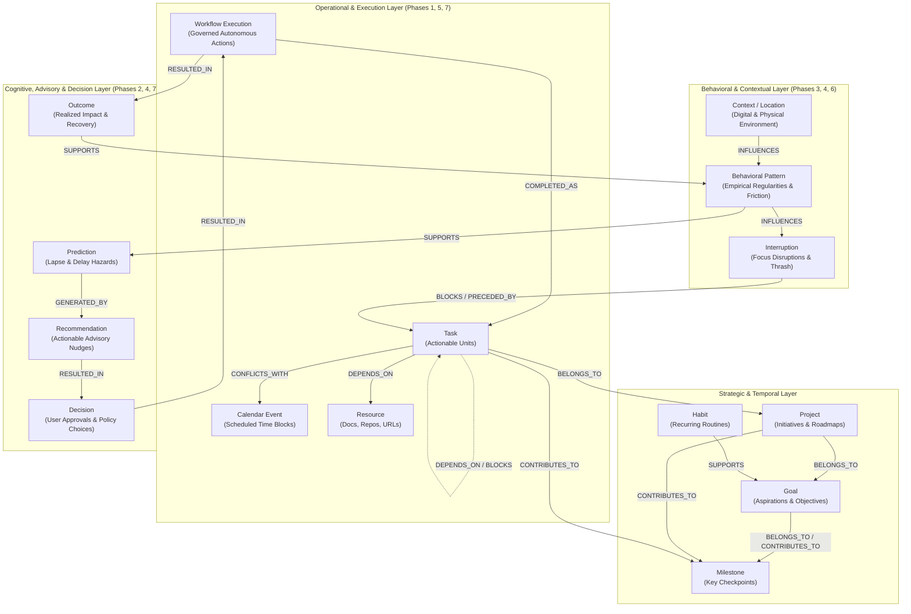

# ContextIQ Phase 8: Unified Productivity Knowledge Graph
## Architecture Specification & Intelligence Audit (Phase 8.1)

---

## 1. Executive Summary & Architectural Vision

Across Phases 1 through 7, ContextIQ grew from an analytical micro-delay logger into a governed autonomous behavioral optimization platform:
- **Phase 1**: Relational task lifecycle, manual interruption logging, and baseline REST API.
- **Phase 2**: Machine learning prospective lapse prediction, population Cox survival baselines, Platt/Isotonic probability calibration, and SHAP explainability.
- **Phase 3**: Passive Windows desktop behavioral telemetry, automated interruption classification, work session reconstruction, and cognitive recovery analytics (Behavioral Friction Index, resumption lag).
- **Phase 4**: Personal Behavioral Profiles (Digital Twin), circadian focus-window discovery, multi-objective task prioritization, 14 personalized interventions, and contextual bandit adaptation (LinUCB / Thompson Sampling).
- **Phase 5**: Two-way external calendar integration (Google Calendar & Microsoft Outlook via Graph API), cross-device session stitching, and privacy-preserving location context boundaries.
- **Phase 6**: Continuous-time state-space dynamics, prospective cognitive recovery survival models, causal structural DAG identification, off-policy counterfactual evaluation (DR-OPE / SnIPW), Pareto-optimal multi-objective scheduling, conformal uncertainty quantification, and in-silico behavioral digital twin simulation.
- **Phase 7**: Governed autonomous workflows, proactive behavioral event triggers, user-defined automation rules, 13-state execution engine, cryptographic audit trails, reversible compensation stacks, and emergency stop kill-switches.

### The Phase 8 Mandate: Unified Knowledge Architecture
Despite the predictive and autonomous sophistication of Phases 1–7, knowledge across ContextIQ remained partitioned across isolated domain silos:
- Tasks knew their status, priority, and parent, but lacked semantic connections to broader **Projects**, **Milestones**, and long-term **Goals**.
- Context sessions and desktop telemetry captured granular application transitions and micro-delays, but could not link these to the specific **Habits** or **Decisions** that triggered them.
- Recommendations and bandit interventions logged user feedback, but could not trace backward through an explicit, navigable evidence DAG to the underlying **Predictions**, **Context Sessions**, or **Telemetry Events** that justified them.
- Autonomous workflow plans executed actions across systems, but their long-term **Outcomes** remained detached from earlier user governance decisions.

**Phase 8 introduces the ContextIQ Unified Productivity Knowledge Graph**: an extensible, semantically rich, multi-relational graph architecture that integrates the user's tasks, projects, strategic goals, behavioral habits, regularities, decisions, calendar events, and historical outcomes into an interconnected graph grounded in strict epistemic provenance.



---

## 2. Comprehensive Entity Audit (Phases 1–7)

Every existing data model across Phases 1 through 7 was audited to evaluate reusability, identify relationship boundaries, and determine required graph extensions.

| Entity | Existing Implementation & Storage | Primary Fields & Existing Relationships | Identified Gaps Addressed by Phase 8 |
|:---|:---|:---|:---|
| **User** | `app.models.user.User` (`users`) | UUID PK, email, persona, focus rhythm, reentry anchor. Has `tasks`, `locations`. | Sits as an isolated user record without direct graph connection to long-term goals, active projects, or evolving behavioral trajectories. |
| **Task** | `app.models.task.Task` (`tasks`) | `parent_task_id`, `context_location_id`, `status`, `priority`. Has `events`, `parent`, `children`. | Hierarchy is strictly limited to self-referential tree structure. Cannot express cross-project dependencies, blocking conditions, milestone contributions, or links to external resources. |
| **TaskEvent** | `app.models.task_event.TaskEvent` (`task_events`) | Append-only event log (`CREATED`, `STARTED`, `PAUSED`, `COMPLETED`). | Events are isolated from contemporaneous desktop interruptions, application switches, and calendar meetings occurring during the same window. |
| **Interruption** | `app.models.interruption.Interruption` (`interruptions`) | User-logged interruptions (`PHONE`, `CALL`, `MESSAGE`, etc.) linked to `task_id` and `location_id`. | Disconnected from automated telemetry detections (`DetectedInterruption`), and lacks causal linkage showing which downstream tasks lapsed as a consequence. |
| **Location** | `app.models.location.Location` (`locations`) | Geofence centroids, radius, `location_type`. | Spatial silo disconnected from habitual patterns (e.g. "always forgets tasks when leaving office") except via binary lookup tables. |
| **ContextSession** | `app.models.context_session.ContextSession` (`context_sessions`) | Windowed desktop telemetry, application breakdown, switch frequency, BFI friction metrics. | Captures micro-delays and focus depth, but cannot express what high-level Goal or Project the user was attempting to advance during that session. |
| **BehaviourMetric** | `app.models.behaviour_metric.BehaviourMetric` (`behaviour_metrics`) | Daily scalar aggregates (`FORGOTTEN_TASK_RATE`, `AVG_INTERRUPTIONS_PER_SESSION`). | Metric values cannot be attributed to specific calendar crunches, bad task estimation, or unmanaged workflow interruptions. |
| **Prediction** | `app.models.prediction.Prediction` (`predictions`) | Append-only ML predictions (`FORGET_RISK`, `OPTIMAL_TIME_WINDOW`, `INTERRUPTION_RISK`). | Predictions expire silently; no graph link tracks whether the user accepted the insight, what intervention resulted, or whether the predicted lapse actually materialized. |
| **Recommendation** | `app.models.recommendation.Recommendation` (`recommendations`) | User-facing advice (`REMINDER`, `SCHEDULE_SHIFT`, `BREAK_SUGGESTION`). | Advisory nudges are loosely linked to a task, but cannot provide a navigable evidence chain tracing back to the predictive models and telemetry patterns that generated them. |
| **RecommendationFeedback** | `app.models.recommendation_feedback.RecommendationFeedback` (`recommendation_feedback`) | Explicit user feedback (`ACCEPTED`, `DISMISSED`, `DEFERRED`). | User feedback is recorded in isolation; it does not feed back into an explicit causal decision node that links to workflow adaptations. |
| **TaskAssociation** | `app.models.task_association.TaskAssociation` (`task_associations`) | Association rule mining pairs (`support`, `lift`, `confidence_score`). | Binary association rules cannot distinguish between causal prerequisites (`DEPENDS_ON`), temporal ordering (`PRECEDED_BY`), and coincidental correlation (`RELATED_TO`). |
| **AutomationRule** | `app.models.automation_rule.AutomationRule` (`automation_rules`) | User-defined rules, triggers, conditions, and actions. | Operates reactively on event streams; rules do not know about project milestones, project deadlines, or strategic goal priorities. |
| **WorkflowDefinition & Execution** | `app.models.workflow_models.*` (`workflow_execution_plans`, `workflow_step_executions`) | Multi-step DAG plans with 13 lifecycle states, execution receipts, and rollback stacks. | Once executed, step side-effects create or alter tasks and calendar blocks, but the system does not maintain a permanent graph edge linking the execution to the resulting domain outcomes. |
| **Behavioral Profile (Digital Twin)** | `app.models.behavioral_profile.UserBehavioralProfile` (`user_behavioral_profiles`) | Evolving parametric representations in JSONB dimensions (focus, interruption, context, temporal). | Behavioral regularities are stored as statistical parameter vectors; specific recurring patterns (e.g. "Post-standup context thrash") are not queryable graph entities. |
| **Calendar Integration & Events** | `app.models.external_calendar_event.ExternalCalendarEvent` (`external_calendar_events`) | Synchronized Google & Outlook events with `linked_task_id`. | External meetings cannot express schedule conflicts with habits, or show how back-to-back meetings degrade afternoon focus windows. |
| **SavedScenario & ProposedWorkflow** | `app.models.simulation_models.*` (`saved_scenarios`, `proposed_workflows`) | In-silico digital twin counterfactual simulations. | Counterfactual scenarios evaluate hypothetical interventions, but hypotheses are not linked into the permanent knowledge graph as grounded evidence. |

---

## 3. Knowledge Graph Entity & Topology Design

To bridge these gaps without creating duplicate data structures or invalidating Phase 1–7 services, the Knowledge Graph employs a **dual-layer architecture**:
1. **Underlying Domain Storage**: Existing Phase 1–7 relational tables remain the authoritative store for operational entities (`tasks`, `users`, `context_sessions`, `workflow_execution_plans`, `external_calendar_events`).
2. **Universal Graph Projection & Adjacency Layer**:
   - `knowledge_graph_nodes`: An index and projection layer assigning a canonical graph identity to any entity across ContextIQ.
   - `knowledge_graph_edges`: A typed, directed adjacency model establishing explicit semantic edges across entities with calibrated confidence, validity windows, and provenance contracts.
   - **Extended Domain Entities**: New first-class tables (`projects`, `goals`, `milestones`, `habits`, `behavioral_patterns`, `decisions`, `outcomes`, `resources`) that expand ContextIQ into long-term strategic alignment.

### 15 Graph Node Types
1. **USER**: Tenant boundary and subject of all behavioral modeling.
2. **TASK**: Actionable work unit (projected from `tasks`).
3. **PROJECT**: Multi-task deliverable container with defined scope, roadmap, and deadlines.
4. **GOAL**: High-level personal, career, or productivity aspiration.
5. **MILESTONE**: Checkpoint deliverable linking tasks and projects to goals.
6. **HABIT**: Recurring behavioral routine or scheduled practice.
7. **BEHAVIORAL_PATTERN**: Empirically identified behavioral regularity or friction pattern.
8. **CONTEXT**: Physical, temporal, or digital work environment (projected from `locations`, `context_sessions`).
9. **INTERRUPTION**: Focus disruption (projected from `interruptions` and `detected_interruptions`).
10. **RECOMMENDATION**: Actionable advisory nudge (projected from `recommendations`).
11. **DECISION**: Recorded choice made by the user or approved autonomous policy.
12. **CALENDAR_EVENT**: External scheduled event (projected from `external_calendar_events`).
13. **WORKFLOW**: Multi-step automated execution plan (projected from `workflow_execution_plans`).
14. **OUTCOME**: Realized empirical impact or completion metric.
15. **RESOURCE**: External artifact, document, repository, URL, or tool.

### 13 Graph Relationship Types
1. **BELONGS_TO**: Strict hierarchical membership (e.g. `Task -> Project`, `Milestone -> Goal`).
2. **DEPENDS_ON**: Hard prerequisite requirement (e.g. `Task B -> Task A`, `Project -> Resource`).
3. **CONTRIBUTES_TO**: Alignment and progress contribution (e.g. `Task -> Milestone`, `Milestone -> Goal`, `Habit -> Goal`).
4. **BLOCKS**: Preventative or obstructive impedance (e.g. `Task A -> Task B`, `Interruption -> Task`).
5. **RELATED_TO**: Co-occurrence or semantic association (e.g. `Task -> Task` via basket association rules).
6. **GENERATED_BY**: Creation provenance (e.g. `Recommendation -> Prediction`, `Outcome -> Workflow`).
7. **INFLUENCES**: Causal or behavioral tendency (e.g. `Context -> Behavioral Pattern`, `Pattern -> Interruption`).
8. **PRECEDED_BY**: Temporal ordering in event streams (e.g. `Task Event -> Context Session`).
9. **RESULTED_IN**: Outcome realization (e.g. `Decision -> Workflow Plan`, `Workflow -> Outcome`).
10. **SUPPORTS**: Justification and empirical grounding (e.g. `Telemetry -> Pattern`, `Prediction -> Recommendation`).
11. **CONFLICTS_WITH**: Incompatibility or temporal collision (e.g. `Calendar Event -> Habit`, `Meeting -> Focus Window`).
12. **COMPLETED_AS**: State realization transition (e.g. `Workflow Step -> Task`, `Plan -> Outcome`).
13. **DERIVED_FROM**: Knowledge synthesis provenance (e.g. `Behavioral Profile -> Context Sessions`).

---

## 4. Graph Storage Strategy: PostgreSQL vs. Graph Databases

A critical architectural decision in Phase 8 is whether to introduce a dedicated graph database (such as Neo4j, Memgraph, or Amazon Neptune) or extend the existing PostgreSQL infrastructure.

### Architectural Evaluation Matrix

| Criterion | Dedicated Graph DB (Neo4j / Memgraph) | Extended PostgreSQL (Adjacency + Recursive CTEs) | ContextIQ Decision |
|:---|:---|:---|:---|
| **Operational Overhead** | Requires managing a secondary database cluster, JVM tuning, separate backup/restore procedures, and separate health monitoring. | Zero new infrastructure; reuses existing AWS RDS / Supabase PostgreSQL cluster, pooling, and automated backups. | **Winner: PostgreSQL** |
| **Transactional Integrity (ACID)** | Cross-system dual-writes between Postgres (Tasks/Workflows) and Neo4j require 2-phase commits or eventual consistency queues, risking desynchronization. | Atomic ACID transactions: Task creation, workflow state transition, and graph edge insertion commit in a single database transaction. | **Winner: PostgreSQL** |
| **Multi-Tenant Security (RLS)** | Graph databases have primitive multi-tenant security; complex custom cypher query filtering required to prevent tenant data leakage. | PostgreSQL native Row-Level Security (RLS) guarantees user isolation (`user_id = auth.uid()`) on every graph node and edge. | **Winner: PostgreSQL** |
| **Query Traversal Performance** | Constant-time pointer hopping for 10+ hop deep graph walks across billions of global edges. | Index-backed recursive CTEs (`WITH RECURSIVE`) provide sub-millisecond traversal for personal graphs (typical user: 1,000–50,000 nodes, 2–6 hops). | **Winner: PostgreSQL** (for personal productivity graphs) |
| **Data Synchronization Latency** | Event bus delay (Kafka/Debezium CDC) between operational DB and graph database means insights lag behind user actions. | Zero lag: Knowledge edges are updated immediately as telemetry, tasks, and workflows mutate. | **Winner: PostgreSQL** |
| **JSONB & Rich Metadata** | Property graphs support basic key-value pairs; nested JSON schemas and array analytics require bespoke query constructs. | Native JSONB with GIN indexing and rich operators (`@>`, `?`, jsonpath) allows rich provenance payloads and SHAP values. | **Winner: PostgreSQL** |

### Decision: Extend PostgreSQL with Relational Adjacency and Recursive CTEs
ContextIQ personal productivity knowledge graphs are inherently **user-scoped** (multi-tenant) with localized graph depths typically between 2 and 6 hops (e.g., Task -> Milestone -> Goal, or Recommendation -> Prediction -> Session -> Interruption). 

Introducing Neo4j or another specialized graph database would introduce architectural novelty at the expense of:
1. Fragmented data consistency and dual-write bugs.
2. Inability to enforce atomic transactional rollbacks during workflow compensation.
3. Substantially higher operational and cloud hosting costs.

PostgreSQL handles ContextIQ's graph requirements with **sub-millisecond latency**, complete ACID reliability, and strict tenant isolation via composite indexes on `(user_id, source_node_id, relationship_type)` and `(user_id, target_node_id, relationship_type)`.

---

## 5. Epistemic Guardrails: Facts vs. Inferred Conclusions

A core design principle of ContextIQ Phase 8 is that **inferred relationships must never masquerade as verified facts**:
- **Verified Facts** (`is_inferred = False`, `confidence = 1.0`): User-entered dependencies, explicit project hierarchies, direct parent-child tasks, logged decisions.
- **Inferred Hypotheses** (`is_inferred = True`, `confidence < 1.0`): Machine learning lapse predictions, statistical association rules, heuristic distraction triggers, LLM-generated task breakdowns.

Every relationship contract enforces this boundary programmatically at the Pydantic schema and service layer:
```python
if is_inferred:
    assert confidence < 1.0, "Inferred relationships cannot claim absolute certainty."
    assert evidence_source != KnowledgeEvidenceSource.EXPLICIT_USER
else:
    assert confidence == 1.0, "Verified facts must have confidence = 1.0."
    assert evidence_source in (KnowledgeEvidenceSource.EXPLICIT_USER, KnowledgeEvidenceSource.APPLICATION_EVENT, KnowledgeEvidenceSource.CALENDAR_IMPORT)
```

Furthermore, multi-hop query traversals compute **path-level confidence attenuation** ($C_{\text{path}} = \prod C_i$) and transparently flag whether any segment of an explanation trail relies on inferred hypotheses.

---

## 6. Integration with Phase 1–7 Subsystems

The Knowledge Graph seamlessly interfaces with all existing ContextIQ subsystems:
- **Phase 1 (Core Tasks & Logging)**: Task mutations automatically synchronize corresponding `TASK` graph nodes; associations populate `RELATED_TO` edges.
- **Phase 2 (Predictive Survival & Forgetting)**: Survival model predictions register `PREDICTION` nodes linked to target tasks via `SUPPORTS` or `INFLUENCES`.
- **Phase 3 (Desktop Telemetry & Sessions)**: Context sessions and detected interruptions project into `CONTEXT` and `INTERRUPTION` nodes, forming the empirical foundation for behavioral regularities.
- **Phase 4 (Behavioral Twin & Bandits)**: Bandit intervention arms and profile snapshots link into `BEHAVIORAL_PATTERN` and `RECOMMENDATION` nodes.
- **Phase 5 (Calendar Integrations & Cross-Device)**: Synchronized calendar events map into `CALENDAR_EVENT` nodes that evaluate `CONFLICTS_WITH` edges against focus windows and tasks.
- **Phase 6 (Causal Modeling & Multi-Objective Optimization)**: Causal DAG structures map directly into `INFLUENCES` and `DERIVED_FROM` graph edges; Pareto schedules link to `Project` milestones.
- **Phase 7 (Governed Autonomous Workflows)**: Autonomous workflows and approval decisions register `WORKFLOW` and `DECISION` nodes, linking executed actions to realized `OUTCOME` nodes.
