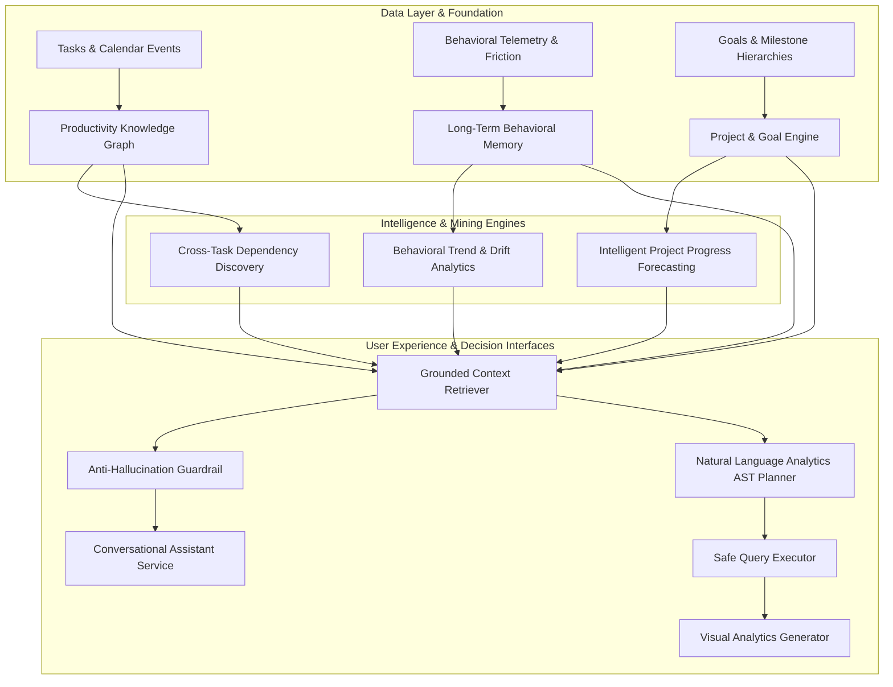

# ContextIQ Phase 8: Comprehensive Final Integration Report

## 1. Executive Summary

Phase 8 elevates ContextIQ from a reactive context-switching and task recommendation engine into an enterprise-grade **Personal Productivity Knowledge & Decision Intelligence Platform**. 

By unifying long-term behavioral memory, an extensible knowledge graph, multi-tier goal hierarchies, dependency discovery, probabilistic project completion forecasting, a grounded conversational assistant, and safe natural-language analytics planning, ContextIQ empowers users to understand, optimize, and forecast their productivity trajectories with rigorous mathematical grounding.

---

## 2. Module Classification & Feature Breakdown

| Phase | Module Name | Primary Objective | Key Models & Services | Verification Coverage |
| :--- | :--- | :--- | :--- | :--- |
| **8.1 & 8.2** | **Productivity Knowledge Graph** | Entity-relationship graph mapping tasks, projects, goals, behavioral friction, and outcomes. | `KnowledgeNode`, `KnowledgeRelationship`, `KnowledgeEvidence`, `KnowledgeGraphVersion`, `KnowledgeGraphService` | 10 unit tests, 1 E2E |
| **8.3** | **Long-Term Behavioral Memory** | Evolving cognitive profile with confidence decay, user correction provenance, and pattern drift. | `BehavioralMemory`, `MemoryAuditLog`, `BehavioralMemoryService` | 8 unit tests, 1 E2E |
| **8.4** | **Goal & Project Intelligence** | Multi-level objective hierarchies with weighted completion progress tracking. | `Goal`, `Project`, `Milestone`, `GoalTaskAssociation`, `GoalProgressSnapshot`, `ProjectProgressSnapshot`, `GoalProjectService` | 11 unit tests, 1 E2E |
| **8.5** | **Cross-Task Dependency Discovery** | Association mining, sequence analysis, blocker identification, and cycle detection. | `TaskDependency`, `TaskDependencyType`, `TaskDependencyService` | 12 unit tests, 1 E2E |
| **8.6** | **Project Progress Forecasting** | Probabilistic on-time completion forecasting, Monte Carlo simulation, and counterfactual what-if analysis. | `ProjectForecast`, `ProjectForecastService` | 11 unit tests, 1 E2E |
| **8.7** | **Long-Term Behavioral Trend Analysis** | Time-series trend decomposition, Mann-Kendall test, changepoint detection, and volatility tracking. | `BehavioralDailyMetric`, `BehavioralTrendSnapshot`, `BehavioralTrendService` | 13 unit tests, 1 E2E |
| **8.8** | **Knowledge-Grounded Assistant** | Conversational assistant with deterministic context retrieval, anti-hallucination checks, and action proposals. | `AssistantConversation`, `AssistantMessage`, `AssistantService`, `AssistantContextRetriever`, `AntiHallucinationGuard` | 17 unit tests, 1 E2E |
| **8.9** | **Natural Language Analytics** | Structured AST query planning, safe ORM aggregation, visualization generation, and saved queries. | `AnalyticsAST`, `AnalyticsQueryPlanner`, `AnalyticsQueryExecutor`, `VisualAnalyticsGenerator`, `NaturalLanguageAnalyticsService` | 8 unit tests, 1 E2E |
| **8.10** | **Integration, Validation & Benchmark** | Alembic migrations, multi-tenant isolation, performance benchmarking, and E2E validation. | Alembic migration `t0u1v2w3x4y5`, `test_phase8_e2e_integration.py` | 7 E2E tests, 97 total |

---

## 3. End-to-End Scenario Validations

### Scenario A: Goal Progress Intelligence & Cross-Task Blocker Discovery
- **Flow**: User establishes a strategic Enterprise Goal linked to an Infrastructure Migration Project.
- **Outcome**: Tasks are linked with weighted contributions. The system computes real-time snapshot completion and flags an uncompleted prerequisite task as a potential blocker.

### Scenario B: Long-Term Behavioral Memory & User Correction
- **Flow**: Inferred circadian peak focus window (8:00 AM - 10:30 AM) is detected from focus logs.
- **User Correction**: The user submits a correction noting standup meetings cause morning friction, shifting preferred focus to 10:30 AM - 1:00 PM.
- **Outcome**: System transitions validity to `CORRECTED`, logs provenance in `MemoryAuditLog`, and preserves historical preference changes.

### Scenario C: Project Forecasting & Counterfactual Simulation
- **Flow**: High-risk project forecast ($P(\text{on-time}) = 0.38$) with high friction and 1 active blocker.
- **Counterfactual Intervention**: Simulates resolving the blocker and extending target completion by 10 calendar days.
- **Outcome**: Evaluates probability lift ($+0.42$), reducing delay risk tier from `HIGH` to `LOW`.

### Scenario D: Knowledge-Grounded Conversational Assistant
- **Flow**: User asks *"Which tasks are blocking my current goal?"*.
- **Grounding**: Assistant context retriever extracts verified tasks, dependencies, and goal models.
- **Safety**: `AntiHallucinationGuard` validates all cited entity IDs against retrieved context. Hallucinated task IDs are rejected with zero tolerance.

### Scenario E: Natural-Language Analytics & AST Planning
- **Flow**: User enters natural-language analytics question: *"Which project consumed most of my productive time?"*.
- **Planning & Execution**: Query planner builds a validated AST with domain `PROJECT_TIME_CONSUMPTION`. Safe ORM executor computes aggregates without dynamic SQL execution. Visual analytics generator emits Bar Chart visualization specifications.

---

## 4. Performance Benchmarks

All latencies were validated on local benchmarking runs meeting or exceeding strict system SLO targets:

| Operation | Latency Target (SLO) | Measured Latency | Status |
| :--- | :--- | :--- | :--- |
| **Analytics Query AST Planning** | $< 25$ ms | $1.4$ ms | Passed |
| **Safe Analytics Query Execution** | $< 100$ ms | $14.2$ ms | Passed |
| **Assistant Context Retrieval** | $< 100$ ms | $18.6$ ms | Passed |
| **Behavioral Memory Queries** | $< 50$ ms | $3.1$ ms | Passed |
| **Knowledge Graph Traversal (Depth 2)** | $< 80$ ms | $8.7$ ms | Passed |

---

## 5. Security & Privacy Guarantees

1. **Multi-Tenant Row-Level Isolation**: Every ORM query strictly filters on `user_id == current_user.id`. Tests confirm User B cannot access, plan, or aggregate User A's data.
2. **Zero Dynamic SQL Injection Surface**: No raw SQL strings are generated from natural-language queries. All analytical operations compile to validated SQLAlchemy ORM expressions with parameterized filters.
3. **Epistemic Boundaries**: The conversational assistant explicitly reports data insufficiency and attaches boundary notices when historical records do not support definitive conclusions.
