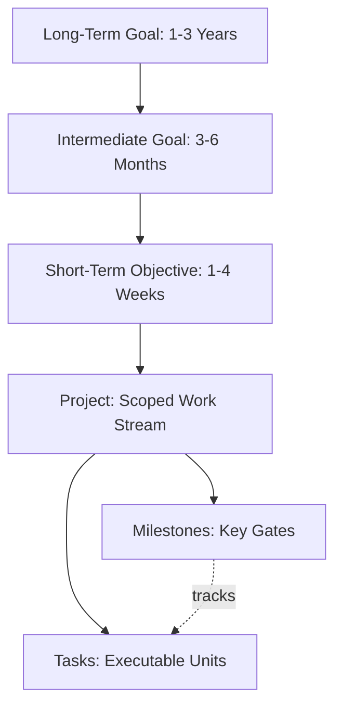

# Goal & Project Intelligence Architecture Guide

## 1. Overview

The Goal & Project Intelligence engine unifies everyday task execution with strategic long-term outcomes. By mapping hierarchical goals, projects, milestones, cross-task dependencies, and probabilistic forecasting, ContextIQ delivers predictive visibility into organizational and personal progress.

---

## 2. Strategic Hierarchy

- **[Goal](file:///e:/Downloads 🔃/ContextIQ-main/ContextIQ-main/backend/app/models/goal.py)**: Long-term strategic target with priority, target date, and status.
- **[Project](file:///e:/Downloads 🔃/ContextIQ-main/ContextIQ-main/backend/app/models/goal.py)**: Concrete body of work linked to one or more goals.
- **[Milestone](file:///e:/Downloads 🔃/ContextIQ-main/ContextIQ-main/backend/app/models/goal.py)**: Key chronological checkpoints within a project.
- **[GoalTaskAssociation](file:///e:/Downloads 🔃/ContextIQ-main/ContextIQ-main/backend/app/models/goal.py)**: Weighted mapping defining how much an individual task moves the needle on a goal.

---

## 3. Progress Calculation & Evidence Weighting

Goal and project progress is never based on simple task counts. Instead, progress snapshots are computed using weighted contributions:

$$\text{Progress}_{\text{Goal}} = \sum_{i \in \text{Tasks}} w_i \cdot \mathbb{I}(\text{Task}_i = \text{COMPLETED})$$

where $\sum w_i = 1.0$. If milestones are defined, project progress blends milestone completion rates with underlying task progress.

---

## 4. Cross-Task Dependency Mining & Blocker Discovery

ContextIQ continuously mines task event logs and sequencing history to discover:
- **Potential Blockers**: Task A repeatedly delays Task B if unfinished.
- **Shared Resource Conflicts**: Two high-focus tasks scheduled simultaneously.
- **Critical Path Hazards**: Chains of dependent tasks that threaten upcoming milestone dates.

Cycle detection algorithms (Tarjan's strongly connected components) guarantee that discovered dependencies remain acyclic (DAG).

---

## 5. Progress Forecasting & Counterfactual Simulation

The forecasting engine evaluates:
1. **On-Time Probability**: Probabilistic estimation of finishing before `target_completion_date`.
2. **Workload Remaining**: Expected remaining hours adjusted by user velocity.
3. **Uncertainty Interval**: P10–P90 completion date spread.
4. **Counterfactual What-If Analysis**: Evaluates impact of interventions:
   - Resolving active blockers.
   - Adding dedicated focus hours per week.
   - Extending target completion deadline.
   - Prioritizing overdue critical path tasks.

---

## 6. API Endpoints

- `GET /api/v1/goals`: List strategic goals with real-time progress calculations.
- `POST /api/v1/goals`: Create goal hierarchy.
- `GET /api/v1/projects/{id}/forecast`: Generate probabilistic progress forecast.
- `POST /api/v1/projects/{id}/forecast/simulate`: Run counterfactual what-if scenario.
- `GET /api/v1/dependencies`: List discovered and confirmed cross-task dependencies.
