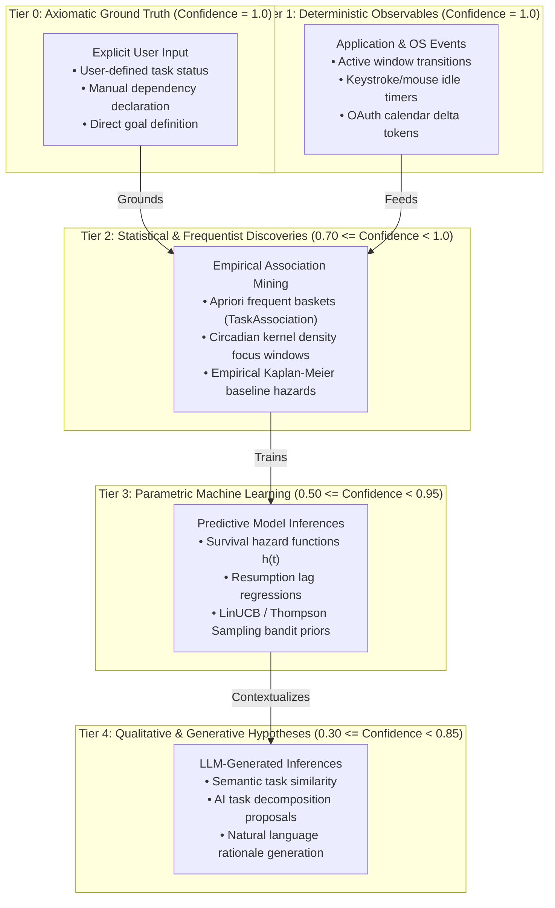

# ContextIQ Knowledge Provenance Model & Query Architecture
## Epistemic Hierarchy, Provenance Storage & Core Queries (Phase 8.1)

---

## 1. Executive Summary & Epistemic Hierarchy

Knowledge in ContextIQ originates from diverse channels, ranging from immutable operating system hardware events to speculative generative AI suggestions.

Without strict provenance tracking, analytical systems suffer from **epistemic drift**: inferred hypotheses become treated as objective facts, compounding error across multi-step planning loops.

To maintain absolute data integrity, ContextIQ establishes a **Five-Tier Knowledge Provenance Hierarchy**:



### Epistemic Tier Matrix

| Provenance Tier | Evidence Source Enum | Typical Confidence | Is Inferred? | Epistemic Status & Governance Policy |
|:---|:---|:---|:---|:---|
| **Tier 0: Axiomatic** | `EXPLICIT_USER` | $1.0$ | `False` | Immutable user preference. Can only be altered or revoked by the user. |
| **Tier 1: Observable** | `APPLICATION_EVENT`, `CALENDAR_IMPORT` | $1.0$ | `False` | Deterministic timestamped sensor stream. Protected against revisionist rewriting. |
| **Tier 2: Statistical** | `STATISTICAL_ANALYSIS` | $0.70 - 0.99$ | `True` | Frequentist regularities. Subject to sample size thresholds ($N \ge 15$) and confidence intervals. |
| **Tier 3: Parametric ML** | `ML_PREDICTION` | $0.50 - 0.95$ | `True` | Supervised model outputs. Calibrated via isotonic regression or Platt scaling. |
| **Tier 4: Generative** | `LLM_HYPOTHESIS` | $0.30 - 0.85$ | `True` | Exploratory AI synthesis. Must require user confirmation or automated validation before state execution. |

---

## 2. Provenance Storage Schema (`provenance_payload`)

Every edge in `knowledge_graph_edges` contains a `provenance_payload` JSONB column. The structure of this payload adapts dynamically to the `evidence_source`:

### 1. Explicit User Input (`EXPLICIT_USER`)
```json
{
  "source_channel": "WEB_DASHBOARD_UI",
  "client_ip_hash": "e3b0c44298fc1c149afbf4c8996fb92427ae41e4649b934ca495991b7852b855",
  "user_action": "DRAG_DROP_DEPENDENCY",
  "user_note": "Task B cannot begin until API endpoints are tested."
}
```

### 2. Deterministic Application Events (`APPLICATION_EVENT`)
```json
{
  "device_id": "win11-workstation-uuid",
  "source_event_ids": [
    "evt_01J98ABC1234",
    "evt_01J98ABC1235"
  ],
  "detection_version": "1.4.0",
  "os_process_name": "Code.exe",
  "window_title_sanitized": "[Project-Root] - VSCode"
}
```

### 3. Statistical Analysis (`STATISTICAL_ANALYSIS`)
```json
{
  "algorithm": "Apriori_Frequent_Itemset",
  "sample_size": 84,
  "support": 0.32,
  "confidence": 0.85,
  "lift": 2.45,
  "p_value": 0.003
}
```

### 4. Machine Learning Predictions (`ML_PREDICTION`)
```json
{
  "model_family": "Dynamic_Cox_Survival_Lapse",
  "model_version": "v2.3.1-prod",
  "training_data_cutoff": "2026-11-20T00:00:00Z",
  "calibration_method": "isotonic",
  "raw_probability": 0.78,
  "calibrated_probability": 0.82,
  "conformal_interval": [0.74, 0.89],
  "top_shap_factors": [
    {"feature": "consecutive_meetings_prior", "shap_value": 0.34},
    {"feature": "afternoon_time_window", "shap_value": 0.22}
  ]
}
```

### 5. Generative AI Hypotheses (`LLM_HYPOTHESIS`)
```json
{
  "model_name": "gemini-pro-reasoning",
  "prompt_template_id": "tpl_task_decomposition_v3",
  "temperature": 0.2,
  "prompt_token_count": 512,
  "semantic_similarity_score": 0.81,
  "reasoning_rationale": "Identified architectural coupling between DB schema migration and API router definition."
}
```

---

## 3. The 6 Reusable Query Operations

Phase 8 implements six standardized, production-ready query operations for exploring the unified knowledge graph. Each query combines relational indexes, recursive Common Table Expressions (CTEs), and strict multi-tenant boundaries.

---

### Query 1: Find Related Tasks

**Objective**: Given a task, retrieve all directly and associatively related tasks, spanning dependencies, sequential links, blocking conditions, and frequent co-occurrence baskets.

```sql
WITH RECURSIVE task_node AS (
    SELECT id, entity_id 
    FROM knowledge_graph_nodes 
    WHERE user_id = :user_id 
      AND node_type = 'TASK' 
      AND entity_id = :task_id
)
SELECT 
    t.id AS task_id,
    t.title,
    e.relationship_type,
    e.confidence,
    e.is_inferred,
    e.evidence_source,
    t.status,
    t.priority
FROM knowledge_graph_edges e
JOIN knowledge_graph_nodes kn ON (
    (e.source_node_id = (SELECT id FROM task_node) AND e.target_node_id = kn.id)
    OR
    (e.target_node_id = (SELECT id FROM task_node) AND e.source_node_id = kn.id)
)
JOIN tasks t ON kn.entity_id = t.id
WHERE e.user_id = :user_id
  AND kn.node_type = 'TASK'
  AND e.relationship_type IN ('RELATED_TO', 'DEPENDS_ON', 'BLOCKS', 'PRECEDED_BY', 'SUPPORTS')
ORDER BY e.confidence DESC;
```

---

### Query 2: Find Project Dependencies & Detect Bottlenecks

**Objective**: Traverse the directed dependency DAG for a project and its constituents to discover transitive prerequisites, evaluate completion states, and flag whether the project is currently blocked.

```sql
WITH RECURSIVE project_deps AS (
    -- Anchor: Dependencies directly attached to the project
    SELECT 
        kn.id AS node_id,
        kn.entity_id,
        kn.node_type,
        kn.name,
        1 AS depth,
        e.relationship_type
    FROM knowledge_graph_nodes root_node
    JOIN knowledge_graph_edges e ON e.source_node_id = root_node.id
    JOIN knowledge_graph_nodes kn ON e.target_node_id = kn.id
    WHERE root_node.user_id = :user_id
      AND root_node.node_type = 'PROJECT'
      AND root_node.entity_id = :project_id
      AND e.relationship_type IN ('DEPENDS_ON', 'BLOCKS')

    UNION ALL

    -- Recursive step: Traverse dependencies of dependencies
    SELECT 
        child_kn.id AS node_id,
        child_kn.entity_id,
        child_kn.node_type,
        child_kn.name,
        pd.depth + 1,
        e.relationship_type
    FROM project_deps pd
    JOIN knowledge_graph_edges e ON e.source_node_id = pd.node_id
    JOIN knowledge_graph_nodes child_kn ON e.target_node_id = child_kn.id
    WHERE e.user_id = :user_id
      AND e.relationship_type IN ('DEPENDS_ON', 'BLOCKS')
      AND pd.depth < 10
)
SELECT 
    pd.*,
    COALESCE(t.status::text, m.status, 'UNKNOWN') AS status,
    CASE 
        WHEN pd.node_type = 'TASK' AND t.status NOT IN ('COMPLETED', 'CANCELLED') THEN TRUE
        WHEN pd.node_type = 'MILESTONE' AND m.status <> 'REACHED' THEN TRUE
        ELSE FALSE
    END AS is_blocking
FROM project_deps pd
LEFT JOIN tasks t ON pd.node_type = 'TASK' AND pd.entity_id = t.id
LEFT JOIN milestones m ON pd.node_type = 'MILESTONE' AND pd.entity_id = m.id
ORDER BY pd.depth ASC;
```

---

### Query 3: Find Goals Affected by Unfinished Tasks

**Objective**: Perform upward transitive graph traversal from an unfinished task to discover impacted strategic goals, calculating delay hazard cascade risks: $\text{Task} \to \text{Milestone} \to \text{Goal}$.

```sql
WITH RECURSIVE upward_impact AS (
    -- Anchor: Task node
    SELECT 
        kn.id AS node_id,
        kn.entity_id,
        kn.node_type,
        kn.name,
        ARRAY[kn.name::text] AS impact_path,
        1 AS depth
    FROM knowledge_graph_nodes kn
    WHERE kn.user_id = :user_id
      AND kn.node_type = 'TASK'
      AND kn.entity_id = :unfinished_task_id

    UNION ALL

    -- Recursive step: Walk upward via CONTRIBUTES_TO or BELONGS_TO
    SELECT 
        parent_kn.id AS node_id,
        parent_kn.entity_id,
        parent_kn.node_type,
        parent_kn.name,
        ui.impact_path || parent_kn.name::text,
        ui.depth + 1
    FROM upward_impact ui
    JOIN knowledge_graph_edges e ON e.source_node_id = ui.node_id
    JOIN knowledge_graph_nodes parent_kn ON e.target_node_id = parent_kn.id
    WHERE e.user_id = :user_id
      AND e.relationship_type IN ('CONTRIBUTES_TO', 'BELONGS_TO')
      AND ui.depth < 6
)
SELECT 
    g.id AS goal_id,
    g.title AS goal_title,
    g.category,
    ui.impact_path,
    g.progress_pct
FROM upward_impact ui
JOIN goals g ON ui.node_type = 'GOAL' AND ui.entity_id = g.id
WHERE g.user_id = :user_id;
```

---

### Query 4: Trace Recommendation to Evidence Trail

**Objective**: Backwards explainability trace discovering every predictive, statistical, and telemetry piece of evidence supporting an advisory recommendation.

```sql
WITH RECURSIVE evidence_walk AS (
    -- Anchor: Recommendation node
    SELECT 
        kn.id AS current_node_id,
        kn.entity_id,
        kn.node_type,
        kn.name,
        1 AS step,
        1.0::float AS path_confidence,
        FALSE AS has_inferred
    FROM knowledge_graph_nodes kn
    WHERE kn.user_id = :user_id
      AND kn.node_type = 'RECOMMENDATION'
      AND kn.entity_id = :recommendation_id

    UNION ALL

    -- Recursive step: Walk incoming edges (GENERATED_BY, SUPPORTS, DERIVED_FROM)
    SELECT 
        source_kn.id AS current_node_id,
        source_kn.entity_id,
        source_kn.node_type,
        source_kn.name,
        ew.step + 1,
        ew.path_confidence * e.confidence,
        ew.has_inferred OR e.is_inferred
    FROM evidence_walk ew
    JOIN knowledge_graph_edges e ON e.target_node_id = ew.current_node_id
    JOIN knowledge_graph_nodes source_kn ON e.source_node_id = source_kn.id
    WHERE e.user_id = :user_id
      AND e.relationship_type IN ('GENERATED_BY', 'SUPPORTS', 'DERIVED_FROM')
      AND ew.step < 6
)
SELECT * FROM evidence_walk ORDER BY step ASC;
```

---

### Query 5: Identify Recurring Behavioral Patterns

**Objective**: Query discovered behavioral regularities, ordering by friction impact ($BFI$ delta), and resolving all linked entities via bidirectional graph traversal.

```sql
SELECT 
    bp.id AS pattern_id,
    bp.name,
    bp.pattern_category,
    bp.description,
    bp.frequency_per_week,
    bp.friction_impact,
    bp.confidence,
    bp.empirical_metrics
FROM behavioral_patterns bp
WHERE bp.user_id = :user_id
  AND (:category IS NULL OR bp.pattern_category = :category)
ORDER BY bp.friction_impact DESC, bp.frequency_per_week DESC;
```

---

### Query 6: Trace Outcomes to Earlier Decisions & Workflows

**Objective**: Trace backwards from realized productivity outcomes to identify the causal chain of decisions and autonomous workflow execution plans that generated them: $\text{Outcome} \leftarrow \text{Workflow} \leftarrow \text{Decision}$.

```sql
SELECT 
    o.id AS outcome_id,
    o.title AS outcome_title,
    o.outcome_type,
    o.metric_impact,
    d.id AS decision_id,
    d.decision_type,
    d.chosen_option,
    d.rationale,
    d.decided_at,
    e.confidence AS attribution_confidence,
    e.is_inferred
FROM outcomes o
JOIN knowledge_graph_nodes onode 
  ON onode.user_id = o.user_id AND onode.node_type = 'OUTCOME' AND onode.entity_id = o.id
JOIN knowledge_graph_edges e 
  ON e.target_node_id = onode.id AND e.relationship_type IN ('RESULTED_IN', 'COMPLETED_AS')
JOIN knowledge_graph_nodes dnode 
  ON dnode.id = e.source_node_id AND dnode.node_type = 'DECISION'
JOIN decisions d 
  ON d.id = dnode.entity_id
WHERE o.user_id = :user_id
  AND o.id = :outcome_id;
```

---

## 4. Inference Decay Schedules & Epistemic Refreshing

Inferred facts are not eternal truths. Inferred behavioral patterns, predictions, and associations decay over time if not refreshed by new empirical telemetry:

$$\text{Confidence}(t) = \text{Confidence}_0 \cdot e^{-\lambda (t - t_0)}$$

Where:
- $\lambda_{\text{telemetry}} = 0.05 \text{ day}^{-1}$ (Desktop session patterns decay over $\approx 20$ days without corroborating data).
- $\lambda_{\text{prediction}} = 0.20 \text{ day}^{-1}$ (Prospective lapse predictions decay rapidly as context evolves).
- $\lambda_{\text{association}} = 0.02 \text{ day}^{-1}$ (Apriori basket rules persist longer unless counter-evidence is logged).

Whenever $\text{Confidence}(t) < 0.30$, the edge is marked as `EXPIRED` (`valid_until \le \text{NOW()}`) and excluded from proactive intervention generation until recomputed by background ML pipelines.
