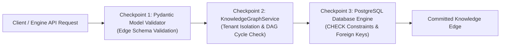

# ContextIQ Relationship Contracts & Epistemic Boundaries
## Formal Graph Contract Specification (Phase 8.1)

---

## 1. Executive Contract Principles

In ContextIQ Phase 8, graph edges are not arbitrary unvalidated pointers. Every edge represents a **binding relationship contract** between two nodes within the user's personal knowledge graph.

### Core Contract Tenets
1. **Strict Multi-Tenant Isolation**: An edge cannot cross tenant boundaries under any circumstances. Source node, target node, and the edge itself must share the identical `user_id`.
2. **Epistemic Demarcation**: Verified facts are strictly separated from inferred conclusions.
   - Ground-truth facts must have `is_inferred = False` and `confidence = 1.0`.
   - Inferred hypotheses must have `is_inferred = True` and $0.0 \le \text{confidence} < 1.0$.
   - Explicit user declarations cannot be marked as inferred.
   - Algorithmic outputs (ML, statistics, heuristics, LLMs) cannot be marked as axiomatic ground truth.
3. **Temporal Boundedness**: When applicable, relationships define explicit validity intervals via `valid_from` and `valid_until`. Expired relationships are preserved for historical audit trails but excluded from active operational traversals.
4. **Immutable Provenance Requirement**: Inferred edges must attach a structured `provenance_payload` documenting the model version, algorithm, training cutoff, supporting event IDs, and feature attribution.

---

## 2. Permissible Node Pairings by Relationship Type

To prevent semantic nonsensical connections (e.g. an Interruption "BELONGS_TO" a Goal), the Knowledge Graph enforces a strict matrix of permissible source and target node pairs:

| Relationship Type | Allowed Source Types | Allowed Target Types | Transitivity | Cycle Policy |
|:---|:---|:---|:---|:---|
| **BELONGS_TO** | `TASK`, `MILESTONE`, `PROJECT` | `PROJECT`, `GOAL` | Transitive | Strict DAG (Cycles Prohibited) |
| **DEPENDS_ON** | `TASK`, `PROJECT`, `WORKFLOW` | `TASK`, `RESOURCE`, `DECISION`, `MILESTONE` | Transitive | Strict DAG (Cycles Prohibited) |
| **CONTRIBUTES_TO** | `TASK`, `MILESTONE`, `HABIT`, `PROJECT` | `MILESTONE`, `GOAL` | Transitive | Strict DAG (Cycles Prohibited) |
| **BLOCKS** | `TASK`, `INTERRUPTION`, `CALENDAR_EVENT` | `TASK`, `WORKFLOW`, `HABIT` | Non-Transitive | Monitored (Preemption Triggers) |
| **RELATED_TO** | `TASK`, `RESOURCE`, `PROJECT` | `TASK`, `RESOURCE`, `PROJECT` | Non-Transitive | Symmetric / Cyclic Permitted |
| **GENERATED_BY** | `RECOMMENDATION`, `OUTCOME`, `WORKFLOW` | `PREDICTION`, `DECISION`, `WORKFLOW`, `PATTERN` | Non-Transitive | Acyclic Provenance |
| **INFLUENCES** | `CONTEXT`, `BEHAVIORAL_PATTERN`, `HABIT` | `BEHAVIORAL_PATTERN`, `INTERRUPTION`, `TASK`, `OUTCOME` | Directed | Causal DAG Constraints |
| **PRECEDED_BY** | `TASK`, `INTERRUPTION`, `DECISION`, `CONTEXT` | `TASK`, `INTERRUPTION`, `DECISION`, `CONTEXT` | Transitive | Strict Total/Partial Order |
| **RESULTED_IN** | `DECISION`, `WORKFLOW`, `INTERRUPTION` | `WORKFLOW`, `OUTCOME`, `TASK` | Directed | Acyclic |
| **SUPPORTS** | `CONTEXT`, `PREDICTION`, `RESOURCE`, `OUTCOME` | `BEHAVIORAL_PATTERN`, `RECOMMENDATION`, `TASK`, `GOAL` | Directed | Grounding Tree |
| **CONFLICTS_WITH** | `CALENDAR_EVENT`, `HABIT`, `TASK` | `CALENDAR_EVENT`, `HABIT`, `TASK` | Symmetric | Monitored (Conflict Resolvers) |
| **COMPLETED_AS** | `WORKFLOW`, `DECISION` | `TASK`, `OUTCOME` | Non-Transitive | Terminal Realization |
| **DERIVED_FROM** | `BEHAVIORAL_PATTERN`, `OUTCOME` | `CONTEXT`, `INTERRUPTION`, `DECISION` | Transitive | Synthesis Provenance DAG |

---

## 3. Formal Contract Schema Attributes

Every row in `knowledge_graph_edges` must satisfy the following contract schema:

```
Contract {
    id: UUID
    user_id: UUID                     -- Mandatory tenant ownership
    source_node_id: UUID              -- References knowledge_graph_nodes.id
    target_node_id: UUID              -- References knowledge_graph_nodes.id
    source_entity_id: UUID            -- Fast lookup foreign key
    target_entity_id: UUID            -- Fast lookup foreign key
    relationship_type: Enum           -- One of the 13 GraphRelationshipType
    evidence_source: Enum             -- EXPLICIT_USER | APPLICATION_EVENT | CALENDAR_IMPORT | 
                                      -- STATISTICAL_ANALYSIS | ML_PREDICTION | LLM_HYPOTHESIS
    confidence: Float                 -- 0.0 <= confidence <= 1.0
    is_inferred: Boolean              -- True if derived; False if ground truth
    weight: Float                     -- Edge strength or traversal cost (default 1.0)
    valid_from: TimestampTZ           -- Activation timestamp
    valid_until: Optional[TimestampTZ]-- Expiration timestamp (NULL = indefinitely valid)
    provenance_payload: JSONB         -- Origin audit trail, model metadata, and explainability
}
```

---

## 4. Epistemic Demarcation & Invalidation Rules

### Rule 1: The Axiomatic Ground-Truth Contract
A relationship is classified as an **Axiomatic Ground-Truth Fact** if and only if it originates directly from:
1. Explicit user input in the UI (e.g., user drag-and-drops Task B under Task A as a dependency).
2. Direct application events generated by local OS hooks (e.g. active window switch timestamped by desktop agent).
3. Authoritative third-party sync receipts (e.g., Google Calendar delta-sync confirmed meeting).

**Contract Requirements:**
- `is_inferred`: MUST be `False`.
- `confidence`: MUST be exactly `1.0`.
- `evidence_source`: MUST be `EXPLICIT_USER`, `APPLICATION_EVENT`, or `CALENDAR_IMPORT`.

### Rule 2: The Inferred Hypothesis Contract
A relationship is classified as an **Inferred Hypothesis** if it was synthesized by:
1. Frequent itemset / association rule mining (`mlxtend` basket mining).
2. Supervised machine learning or survival regression models (Cox models, LightGBM lapse hazard).
3. Contextual bandit policy estimations (LinUCB / Thompson Sampling).
4. Heuristic pattern recognition engines.
5. Large Language Model semantic reasoning.

**Contract Requirements:**
- `is_inferred`: MUST be `True`.
- `confidence`: MUST be strictly less than 1.0 ($0.0 \le \text{confidence} < 1.0$).
- `evidence_source`: MUST be `STATISTICAL_ANALYSIS`, `ML_PREDICTION`, or `LLM_HYPOTHESIS`.
- `provenance_payload`: MUST contain `model_version`, `feature_attribution`, and `discovery_timestamp`.

### Rule 3: Rejection of Self-Loops
Self-referential edges (`source_node_id == target_node_id`) are rejected with `BadRequestError`. Circular dependencies within a single entity violate the acyclic requirement of task execution.

### Rule 4: Rejection of Cross-Tenant Leakage
Any edge where `source_node.user_id != user_id` or `target_node.user_id != user_id` fails authorization and triggers `NotFoundError` or `PermissionDeniedError`.

---

## 5. Confidence Attenuation Across Multi-Hop Query Paths

When querying graph chains containing multi-hop dependencies (such as tracing a Recommendation back through Predictions, Sessions, and Telemetry), the effective confidence along path $P = (e_1, e_2, \dots, e_k)$ attenuates according to the product t-norm:

$$C_{\text{path}} = \prod_{i=1}^{k} \text{confidence}(e_i)$$

### Epistemic Tainting Flag (`has_inferred_steps`)
If ANY edge $e_i \in P$ has $e_i.\text{is\_inferred} = \text{True}$, the entire result path is flagged with:
$$\text{has\_inferred\_steps} = \text{True}$$

This guarantees that user interfaces and autonomous planners never present a multi-hop inference as an immutable truth.

---

## 6. Contract Violation Handling & Enforcement

Contract validation is enforced at three architectural checkpoints:



1. **Checkpoint 1 (Pydantic Schema)**:
   Rejects invalid confidence bounds, conflicting `is_inferred` flags, and incompatible evidence sources before database execution.
2. **Checkpoint 2 (Service Layer)**:
   Verifies tenant node ownership, validates permissible node type pairs, checks for existing duplicate edges, and runs topological cycle detection for DAG relationships (`DEPENDS_ON`, `BELONGS_TO`).
3. **Checkpoint 3 (PostgreSQL Constraints)**:
   Enforces database-level guarantees:
   - `CONSTRAINT chk_kg_no_self_loop CHECK (source_node_id <> target_node_id)`
   - `CONSTRAINT chk_kg_confidence_bounds CHECK (confidence >= 0.0 AND confidence <= 1.0)`
   - Foreign key cascade integrity on user deletion.
