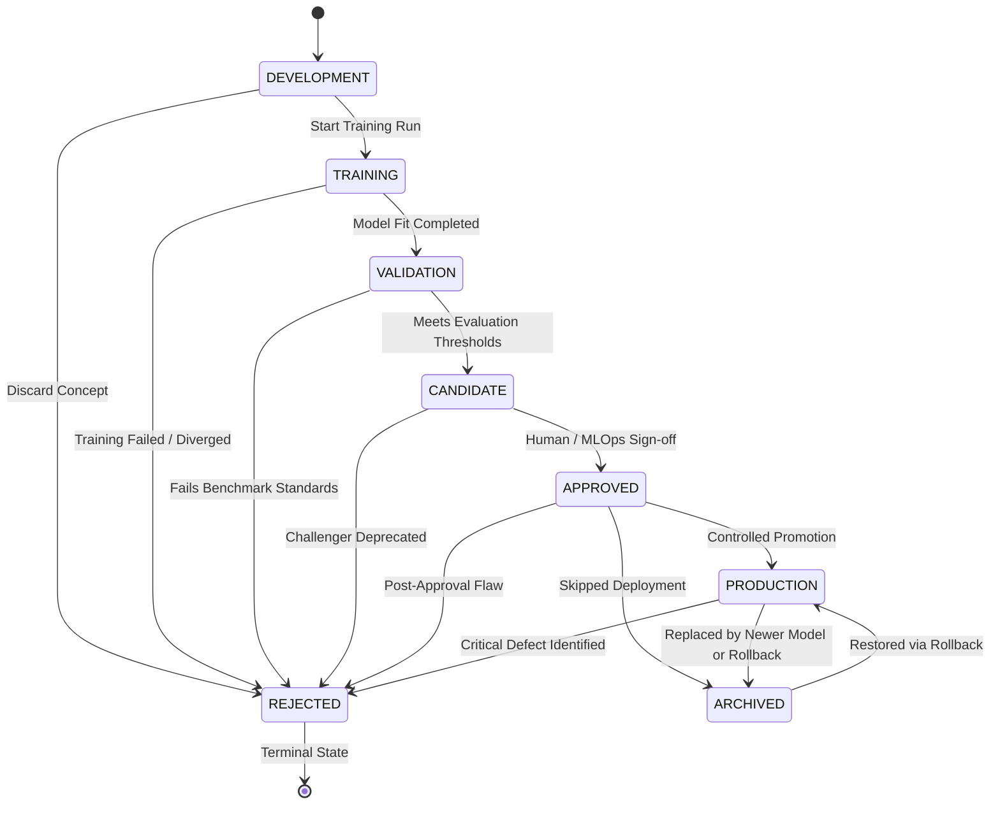

# ContextIQ — Model Registry Architecture & Production Lifecycle Report
**Phase 2.9 Deliverable**

---

## 1. Executive Summary

In Phase 2.9, ContextIQ introduced an enterprise-grade **Centralized Model Registry** and **Production ML Lifecycle System**. Prior to this phase, trained model bundles were stored as flat files without cryptographic integrity verification, formal lifecycle stages, version selection during inference, or audit trails.

The new subsystem delivers:
1. **Centralized Metadata Catalog**: Persisted in `artifacts/model_catalog.json` with tracking of dataset version, schema version, hyperparameters, evaluation metrics, calibration configs, and SHAP compatibility.
2. **8-Stage Model Lifecycle State Machine**: Strictly validates progression across `DEVELOPMENT`, `TRAINING`, `VALIDATION`, `CANDIDATE`, `APPROVED`, `PRODUCTION`, `ARCHIVED`, and `REJECTED`.
3. **Immutable Versioned Storage with SHA-256 Checksums**: Artifacts are stored under `artifacts/models/{task_type}/{model_name}/{version}/model_bundle.joblib` and verified cryptographically on load.
4. **Enhanced Inference Serving**: Dynamic version selection, thread-safe model caching, latency timing (`inference_latency_ms`), and timeout protection.
5. **Distinct Survival Model Registration**: Separation of survival analysis from binary classification, respecting distinct inference contracts ($S(t)$, hazard rates, median survival time, C-index).
6. **Administrative Security & Audit Ledger**: Protected endpoints requiring administrative authentication and append-only audit logging in `artifacts/model_registry_audit.jsonl`.

---

## 2. Model Lifecycle State Machine

The Model Registry implements a formal finite-state machine (FSM). Arbitrary state jumps and unauthorized promotions are strictly rejected at runtime.

### State Transition Diagram



### Transition Enforcement Invariants
- **Single Active Production Model Invariant**: For any given `task_type` (`binary_classification` or `survival_analysis`), **at most one** model may be in `PRODUCTION` at any time. Promoting a new model automatically transitions the existing production model to `ARCHIVED`.
- **Terminal Rejection Invariant**: Models marked `REJECTED` cannot be resurrected directly to `PRODUCTION`. A new iteration must be trained and validated.
- **Rollback Capability**: An `ARCHIVED` model can be promoted back to `PRODUCTION` provided its SHA-256 checksum passes verification.

---

## 3. Cryptographic Artifact Management

Artifacts are organized into structured, versioned directories:
```
artifacts/models/
├── binary_classification/
│   ├── logistic_regression/
│   │   ├── v1.1.0/
│   │   │   └── model_bundle.joblib
│   │   └── v1.2.0/
│   │       └── model_bundle.joblib
│   └── random_forest/
│       └── v1.0.0/
│           └── model_bundle.joblib
└── survival_analysis/
    └── cox_proportional_hazards/
        └── v2.3.0/
            └── model_bundle.joblib
```

### Integrity & Security Controls
1. **SHA-256 Checksum Calculation**: Every artifact has its cryptographic hash calculated upon save and stored in `ModelMetadata.artifact_checksum`.
2. **On-Load Integrity Validation**: When an artifact is loaded by the predictor or registry, the file is streamed and its SHA-256 hash is computed. If bit rot, corruption, or manual file tampering has occurred, a `ChecksumMismatchError` is raised and loading halts.
3. **Immutability (Overwrite Protection)**: Calling `ArtifactStore.save_artifact` for an existing version directory raises `ArtifactOverwriteError` unless `overwrite=True` is explicitly specified.
4. **Feature Schema Verification**: Bundles must define `categorical_features` and `numeric_features` containing all active features defined in `ml/features/feature_spec.py`.

---

## 4. Evaluation of MLflow vs ContextIQ Lightweight Local Registry

As required by Task 6, an engineering evaluation was performed to determine whether to introduce MLflow or maintain a lightweight, file-backed registry:

| Dimension | External MLflow Server | ContextIQ Lightweight Registry (Implemented) |
|---|---|---|
| **Infrastructure Overhead** | High (Requires backend database [PostgreSQL/MySQL], object store [S3/GCS], and standalone tracking daemon). | **Zero** (Pure Python, transactional JSON catalog, standard filesystem storage). |
| **Operational Complexity** | Multi-service orchestration, separate credentials, daemon health monitoring, network latency. | **Self-contained** inside `forgetting-ml`, atomic updates, native CI/CD compatibility. |
| **Metadata Compatibility** | Standard MLflow metadata schema (run IDs, tags, metrics, params, artifacts). | **Directly mirrors MLflow concepts** (`model_id`, `version`, `metrics`, `lifecycle_state`). |
| **Inference Latency** | Network hop to query model URI or registry daemon. | **Sub-millisecond** in-memory dictionary lookup with thread-safe caching. |
| **Auditability** | Database audit logs or enterprise MLflow governance. | **Append-only immutable JSONL** (`artifacts/model_registry_audit.jsonl`). |

### Verdict & Roadmap
For ContextIQ's current single-host microservice and local developer ergonomics, **the lightweight file-backed registry is strictly superior**. It introduces zero deployment friction, requires no additional background services, provides deterministic unit tests, and can be easily migrated to an MLflow Tracking Server in the future by pointing the artifact store and metadata exporter to MLflow Client APIs.

---

## 5. Experiment Tracking Integration (Phase 2.4 Bridge)

The Model Registry integrates with the Phase 2.4 experiment registry (`artifacts/experiment_registry.json`) via `ModelRegistry.register_from_experiment(experiment_id)`. Successful experiments can be promoted directly to `CANDIDATE` or `APPROVED` registry entries, preserving:
- Original training hyperparameters (`C`, `class_weight`, `max_depth`, etc.).
- Out-of-fold validation metrics (PR-AUC, ROC-AUC, Brier score, ECE).
- Training duration and benchmark latency measurements.

---

## 6. Administrative API Reference

All administrative operations are protected via `verify_admin_access`, requiring `X-Admin-Key` or `Authorization: Bearer <key>`.

| Method | Endpoint | Description | Auth Required |
|---|---|---|:---:|
| `GET` | `/models` | List all registered models (optional filters: `task_type`, `status`, `family`). | No |
| `GET` | `/models/production` | Get active production model(s). | No |
| `GET` | `/models/metrics` | Summary of metrics and counts across registered models. | No |
| `GET` | `/models/health` | Comprehensive integrity check across all registered artifacts. | No |
| `GET` | `/models/{model_id}` | Detailed metadata, checksum, and metrics for a specific model. | No |
| `GET` | `/models/{model_id}/versions` | Version history for a model family. | No |
| `POST` | `/models/{model_id}/approve` | Approve a candidate model for production consideration. | **Yes (Admin)** |
| `POST` | `/models/{model_id}/transition` | Execute arbitrary legal lifecycle transition. | **Yes (Admin)** |
| `POST` | `/models/{model_id}/rollback` | Rollback active production model to a target version. | **Yes (Admin)** |

---

## 7. Initial Registry Catalog State

Upon initialization, the registry automatically bootstraps the active ContextIQ production artifacts:

```json
[
  {
    "model_id": "clf_logreg_v1.1.0",
    "model_name": "logistic_regression",
    "model_version": "1.1.0",
    "model_family": "linear",
    "task_type": "binary_classification",
    "lifecycle_state": "PRODUCTION",
    "artifact_location": "artifacts/model_bundle.joblib",
    "evaluation_metrics": { "pr_auc": 0.4451, "roc_auc": 0.6583, "brier_score": 0.1839 }
  },
  {
    "model_id": "surv_cox_v2.3.0",
    "model_name": "cox_proportional_hazards",
    "model_version": "2.3.0",
    "model_family": "survival",
    "task_type": "survival_analysis",
    "lifecycle_state": "PRODUCTION",
    "artifact_location": "artifacts/survival_bundle.joblib",
    "evaluation_metrics": { "concordance_index": 0.6205, "integrated_brier_score": 0.1412 }
  }
]
```
