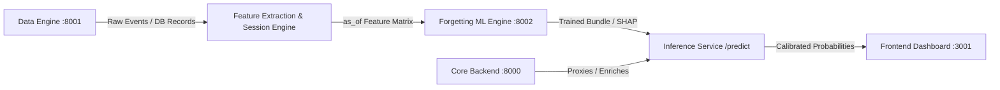
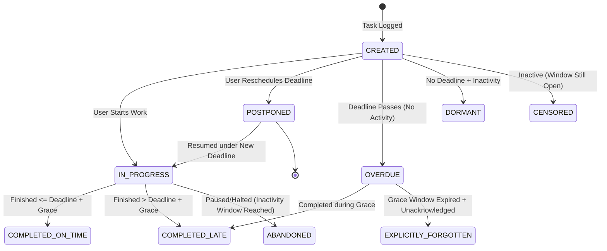

# ContextIQ — Machine Learning Audit Report
**Phase 2.1: Audit of Forgetting Target Pipeline, Temporal Validity, and Behavioral Disaggregation**

*Date: 2026-11-20*  
*Module: `forgetting-ml`, `data-engine`, `backend`*  
*Target Concept: Task Forgetting Risk (`will_forget` / $P(\text{Forget} \mid \text{Context})$)*

---

## 1. Executive Summary

ContextIQ is designed to shift personal productivity from retrospective checklists to proactive behavioral intelligence. A foundational pillar of this vision is the **Forgetting-Risk Engine**, which predicts the probability that an active task will be forgotten before it falls through the cracks.

The existing production baseline is an L2-regularized **Logistic Regression** classifier (calibrated via isotonic regression) achieving:
- **PR-AUC:** `0.4451` (Test set)
- **ROC-AUC:** `0.6583`
- **F1 Score:** `0.4651` (with validation-tuned decision threshold $T = 0.235$)
- **Brier Score:** `0.2273` (uncalibrated) $\rightarrow$ `0.1856` (post-isotonic calibration)
- **Walk-Forward Time-Series CV:** PR-AUC `0.4430 ± 0.0114` (Coefficient of Variation = `2.57%` across 5 temporal folds)

While the engineering infrastructure for time-series cross-validation and feature-level leakage prevention (`_before()` filters) is sound, this audit identifies a **fundamental scientific limitation in the target variable formulation**. The current system reduces all task endpoints to a coarse binary flag:
$$\text{will\_forget} \in \{0, 1\}$$

This conflates fundamentally distinct psychological and behavioral phenomena—such as voluntary postponement, context-switching abandonment, execution delay, and right-censored observations—into a single noisy label.

This report documents the architectural audit of the entire predictive pipeline (Task 1) and provides a rigorous behavioral diagnosis of why the existing target definition fails real-world validity (Task 2).

---

## 2. Comprehensive Repository Audit (Task 1)

### 2.1 Architecture & Pipeline Boundaries

The forgetting risk prediction workflow spans three services:



1. **`data-engine/`**: Responsible for event ingestion (`tasks`, `task_events`, `interruptions`, `locations`), session reconstruction, and generating batch features (`data-engine/pipeline/features.py`).
2. **`forgetting-ml/`**: Responsible for dataset generation, model selection (benchmarking Logistic Regression, Random Forest, XGBoost), probability calibration, SHAP explainability, and serving prediction endpoints.
3. **`backend/`**: Maintains the primary relational models (`Task`, `TaskEvent`, `Prediction`, `BehaviourMetric`) in PostgreSQL/Alembic.

---

### 2.2 Target Generation Logic

Across the repository, target generation was implemented in two parallel paths:

1. **In `forgetting-ml/ml/data/generate_dataset.py`**:
   Synthetic tasks are generated by sampling latent user archetypes ($\text{forgetfulness\_trait}$, $\text{organisation\_trait}$), computing an additive logit score based on 12 features, passing through a sigmoid, and sampling a Bernoulli outcome:
   $$z = \beta_0 + \sum_{i} \beta_i x_i + \epsilon, \quad P(\text{forget}) = \sigma(z), \quad \text{forgotten} \sim \text{Bernoulli}(P)$$
   Each generated row directly receives a flat column `forgotten \in {0, 1}`.

2. **In `data-engine/pipeline/features.py`**:
   The batch feature matrix computes the target as:
   ```python
   # data-engine/pipeline/features.py:455
   "will_forget": int(status_low == "forgotten")
   ```
   Similarly, `data-engine/docs/PIPELINE.md` specifies:
   $$\text{will\_forget} = 1 \text{ if task.status == 'forgotten' else } 0$$

---

### 2.3 Existing Status & Event Taxonomies

The database models define the following task statuses and event types:

| Model / Module | Status / Event Values |
|---|---|
| `backend/app/models/enums.py` (`TaskStatus`) | `PENDING`, `IN_PROGRESS`, `PAUSED`, `COMPLETED`, `FORGOTTEN`, `CANCELLED` |
| `backend/app/models/enums.py` (`TaskEventType`) | `CREATED`, `STARTED`, `PAUSED`, `RESUMED`, `COMPLETED`, `FORGOTTEN`, `CANCELLED` |
| `data-engine/app/models/task.py` (`TaskStatus`) | `created`, `started`, `paused`, `resumed`, `completed`, `forgotten`, `cancelled` |

---

### 2.4 Timestamp & Feature Alignment Audit

| Pipeline Dimension | Implementation | Audit Finding |
|---|---|---|
| **Prediction Timestamp ($T_{\text{pred}}$)** | Set to `task.created_at`. | **Valid**. Represents the exact moment a task enters the system. |
| **Historical Feature Boundary** | Filtered using strict `_before(df, col, as_of=task.created_at)`. | **Valid**. Historical completion/forgetting counts, friction scores, and switch rates use only events strictly before $T_{\text{pred}}$. |
| **Label Materialization Timestamp ($T_{\text{label}}$)** | Derived from final row status at extraction time. | **Defect: No Observation Window Gate**. Incomplete tasks that have not reached a terminal state by extraction time are arbitrarily labeled `0` or filtered without right-censoring checks. |
| **Deadline Distance** | `deadline_distance_hours = (deadline_at - created_at).total_seconds() / 3600.0`. | **Defect: Static Planning Slack Only**. Does not evaluate dynamic elapsed time relative to deadline. If `deadline_at` is null, defaults arbitrarily without modeling unscheduled tasks. |
| **Dormant Task Handling** | No dormancy threshold exists. | **Defect**. Tasks without deadlines that sit inactive for months remain `PENDING` or `created` and are treated as `will_forget = 0`. |

---

### 2.5 Temporal Splitting & Preprocessing Audit

- **Splitting Strategy (`ml/training/splits.py`)**:
  - Global chronological split: 70% Train, 15% Validation, 15% Test.
  - Sorting: strictly by `date`, `user_id`, `hour`.
  - Date ranges:
    - Train: `2025-01-01` to `2025-03-07` (34,397 observations)
    - Val: `2025-03-08` to `2025-03-21` (7,357 observations)
    - Test: `2025-03-22` to `2025-04-05` (7,875 observations)
  - Walk-forward CV: 5 expanding temporal folds on Train+Val.
  - Leakage Assertions: Built-in verification (`_assert_no_target_leakage`) confirms cumulative rolling counts match chronological history.
- **Preprocessing (`ml/preprocessing/pipeline.py`)**:
  - Categorical (3 features): `OneHotEncoder(handle_unknown="ignore", sparse_output=False)`.
  - Numeric (13 features): Median imputation + `StandardScaler` (for Logistic Regression) / raw pass-through (for Trees).
  - Transformed dimension: 29 features total.

---

### 2.6 Model Artifact Dependencies

The runtime inference engine (`app/inference.py`) loads `artifacts/model_bundle.joblib` and validates strict metadata contracts:
- `model_version == "1.1.0"`
- Required bundle dictionary keys: `{"model", "raw_model", "preprocessor", "model_name", "model_version", "threshold", "calibrated", "categorical_features", "numeric_features", "feature_names_transformed"}`.
- Explainer binding: Initialized with `ForgettingExplainer` using SHAP `LinearExplainer`.

**Preservation Mandate**: This existing artifact and runtime interface must remain operational and untouched throughout Phase 2.1.

---

## 3. Target Definition Audit: Deconstructing `will_forget` (Task 2)

### 3.1 The Behavioral Flaw of Binary Conflation

The binary label `will_forget = 1` assumes a single monolithic outcome. In reality, task execution in knowledge work exhibits at least **seven distinct behavioral states**:



### 3.2 Granular Behavioral Outcomes

#### 1. Completed on Time (`COMPLETED_ON_TIME`)
- **Definition**: Task lifecycle reached `COMPLETED` at timestamp $T_{\text{comp}} \le T_{\text{deadline}} + W_{\text{grace}}$ (or $T_{\text{comp}}$ exists when no deadline was specified).
- **Cognitive Meaning**: Flawless prospective memory and execution.
- **Label Assignment**: Negative class (`will_forget = 0`).

#### 2. Completed Late / Tardy (`COMPLETED_LATE`)
- **Definition**: Task was completed, but $T_{\text{comp}} > T_{\text{deadline}} + W_{\text{grace}}$.
- **Cognitive Meaning**: The user **did not forget** the task. Prospective retrieval was successful, but execution latency, cognitive underestimation (planning fallacy), or external blockers delayed completion.
- **Current Defect**: Currently labeled as `will_forget = 0` (lumped with on-time completions). This prevents the system from distinguishing between cognitive forgetting and execution friction.
- **Label Assignment**: Distinct outcome; in legacy binary mapping, should be treated as non-forgotten (`will_forget = 0`) but flagged with execution delay metadata.

#### 3. Explicitly Forgotten (`EXPLICITLY_FORGOTTEN`)
- **Definition**: The deadline passed, grace period $W_{\text{grace}}$ expired, no completion event occurred, and the user either acknowledged omission via a prompt or took no action within observation window $W_{\text{obs}}$.
- **Cognitive Meaning**: Complete prospective memory failure. The task slipped from working memory entirely.
- **Label Assignment**: True positive (`will_forget = 1`).

#### 4. Abandoned Tasks (`ABANDONED`)
- **Definition**: Task reached `STARTED` or `PAUSED` (work commenced), but no further activity occurred for $W_{\text{abandon}}$ (e.g., 48 hours), and it never reached `COMPLETED`.
- **Cognitive Meaning**: **Working memory interruption / cognitive friction failure**, not retrieval failure. The user remembered to start, but context switching or task difficulty caused the session to collapse.
- **Current Defect**: Currently indistinguishable from tasks never initiated. Conflating abandonment with explicit forgetting obscures the root cause: an interrupted task needs resumption cues, while a forgotten task needs initial reminders.
- **Label Assignment**: Positive class for task failure (`will_forget = 1`), with sub-classification as `ABANDONED`.

#### 5. Overdue Tasks (`OVERDUE`)
- **Definition**: $T_{\text{deadline}} < T_{\text{obs}} \le T_{\text{deadline}} + W_{\text{grace}}$, with status still `PENDING` or `IN_PROGRESS`.
- **Cognitive Meaning**: Ambiguous in-flight state. The task is late, but the resolution window has not elapsed.
- **Current Defect**: Labeling an overdue task as forgotten while the user is actively working on it introduces severe false positives.
- **Label Assignment**: **Unresolved / Censored**. Excluded from training set until observation window closes.

#### 6. Dormant Tasks (`DORMANT`)
- **Definition**: Tasks created without a deadline that have experienced no interaction for an extended period $W_{\text{dormant}}$ (e.g., $> 14$ days).
- **Cognitive Meaning**: "Someday / maybe" wishlist items or low-priority backlogs.
- **Current Defect**: Currently treated as `will_forget = 0` simply because no `forgotten` event was emitted. This creates massive negative-class label noise.
- **Label Assignment**: Separate category (`DORMANT`); excluded from time-sensitive forgetting prediction training.

#### 7. Intentionally Postponed Tasks (`POSTPONED`)
- **Definition**: User explicitly modified `deadline_at` to a later date, or logged a rescheduling/postponement action.
- **Cognitive Meaning**: **Deliberate executive control and metacognition**. The user remembered the task, evaluated competing demands, and consciously rescheduled it.
- **Current Defect**: In naively implemented systems, deadline breaches prior to rescheduling trigger false `forgotten` flags, penalizing users for healthy time management.
- **Label Assignment**: Negative class (`will_forget = 0`), with postponement lineage tracked.

#### 8. Insufficient Observation History (`CENSORED`)
- **Definition**: Tasks whose observation window remains open at cutoff time:
  $$T_{\text{created}} + W_{\text{obs}} > T_{\text{cutoff}} \quad \text{or} \quad T_{\text{deadline}} + W_{\text{grace}} > T_{\text{cutoff}}$$
- **Cognitive Meaning**: Outcome is unobserved (right-censored).
- **Current Defect**: Treating unobserved tasks as `0` or `1` injects survivorship and censorship bias into the dataset.
- **Label Assignment**: Strictly marked as censored (`is_valid_training_sample = False`); excluded from supervised model training.

---

## 4. Audit Summary & Recommendations

| Issue Identified | Severity | Corrective Action in Phase 2.1 |
|---|---|---|
| Binary conflation of 7 outcomes | **High** | Introduce `label_generator.py` producing `outcome_type` and sanitized `will_forget`. |
| Lack of right-censoring handling | **High** | Implement strict observation window gates and `is_valid_training_sample` flag. |
| Overdue tasks labeled prematurely | **Medium** | Define explicit grace period $W_{\text{grace}} = 4\text{h}$ before outcome resolution. |
| Inability to validate label anomalies | **Medium** | Implement `label_validator.py` with 7 automated data integrity checks. |
| Risk of breaking existing baseline | **Critical** | Freeze existing Logistic Regression artifact and produce baseline reproduction report. |

The formal target definition specification and labeling architecture are detailed in [`TARGET_DEFINITION_SPEC.md`](TARGET_DEFINITION_SPEC.md).
